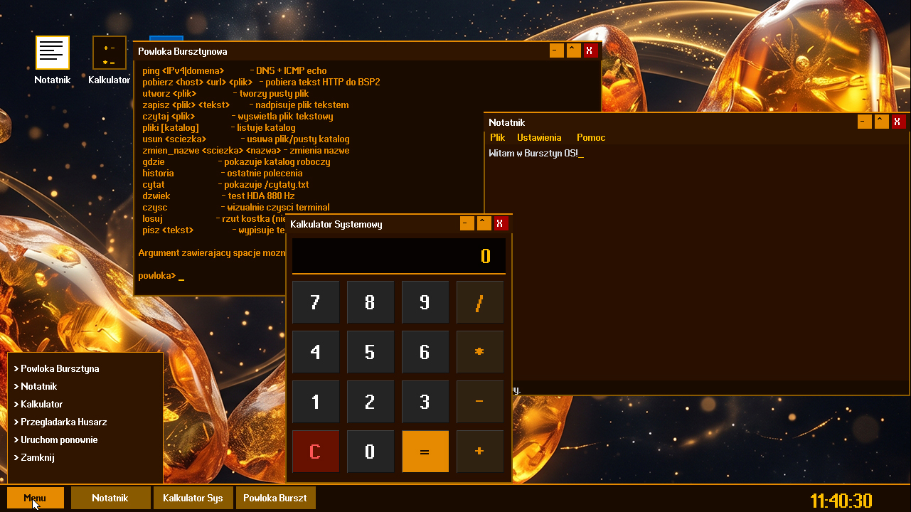
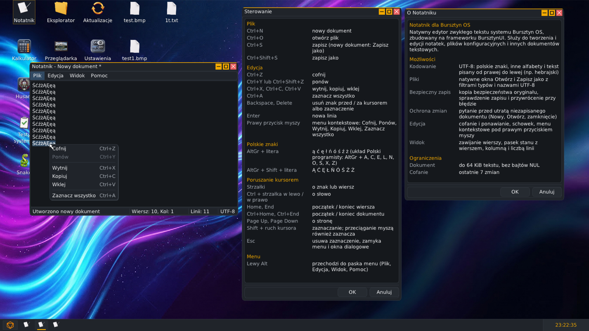

# Bursztyn OS

<p align="center">
  
</p>

**Niezależny, polski system operacyjny x86-64 rozwijany od podstaw.**

Bursztyn OS to eksperymentalny system typu *bare metal*: nie jest dystrybucją Linuksa, nakładką na Windows ani środowiskiem działającym na cudzym jądrze. Rozwijany jest we własnej architekturze systemowej, z jądrem napisanym w C, C++ i asemblerze, natywnymi programami użytkownika oraz autorskim interfejsem graficznym.

> **Status projektu:** aktywny rozwój i testy. Bursztyn OS nie jest jeszcze systemem produkcyjnym ani zamiennikiem systemu do przechowywania ważnych danych. Poszczególne sterowniki i funkcje mają różny poziom dojrzałości; powodzenie testów w QEMU nie oznacza automatycznie zgodności z każdym komputerem.

**Kod autorski: PolyForm Noncommercial License 1.0.0** · **Źródła: publicznie dostępne po opublikowaniu repozytorium** · **Szczegóły: [LICENSE.md](LICENSE.md)**


## Czym jest Bursztyn OS?

Celem projektu jest stworzenie samodzielnego systemu operacyjnego, w którym najważniejsze warstwy — od rozruchu, zarządzania pamięcią i procesami, przez wywołania systemowe i sterowniki, po pulpit — są rozwijane na potrzeby Bursztyn OS.

Podstawowe założenia:

- **Własne jądro i infrastruktura systemowa:** architektura x86-64, tryb Long Mode, pamięć wirtualna, procesy, planista i obsługa przerwań.
- **Natywne aplikacje Ring 3:** programy `.bur`, pakiety aplikacyjne `.cebula` i manifesty uprawnień.
- **BWS — Bursztynowe Wywołania Systemowe:** własny interfejs między programami użytkownika a jądrem.
- **PZB — Poziomy Zaufania Bursztyna:** model logicznych poziomów 0–5 współpracujący ze sprzętową izolacją Ring 0/Ring 3.
- **BursztynUI:** wspólne elementy graficzne i kontrolki dla rodzimych programów.
- **Rozwój niezależnego ekosystemu:** sterowniki, system plików, narzędzia programistyczne oraz docelowa integracja z językiem Avocado.

Do budowania obrazu rozruchowego aktualna gałąź projektu wykorzystuje **GRUB i Multiboot2** w trybie BIOS oraz UEFI/OVMF. Jest to narzędzie startowe, a nie jądro Linuksa. Własny **Bursztynowy Program Rozruchowy (BRB)** pozostaje planowanym kierunkiem rozwoju.

## Aktualne możliwości

Poniższy opis uwzględnia funkcje rozwijane i testowane do listopada 2026 r. Dokładny zakres działania zależy od wersji kodu i sprzętu.

| Obszar | Implementacja / stan |
| --- | --- |
| Jądro | x86-64, mechanizmy pamięci i procesów, Ring 3, obsługa przerwań, planista |
| Rozruch | BIOS i UEFI z GRUB Multiboot2; OVMF w QEMU |
| Grafika | GOP/VESA oraz rozwijane sterowniki graficzne, w tym VirtIO-GPU |
| Interfejs | Własny menedżer okien, pulpit, menu Start, pasek zadań, okna i kontrolki BursztynUI |
| Tekst | UTF-8, polskie znaki, czcionki TTF/OTF oraz ustawienia czcionek |
| Dyski i pliki | Sterowniki i operacje plikowe rozwijane dla środowisk AHCI i VirtIO-BLK; PSF i własne mechanizmy systemu plików |
| Sieć | Własny stos sieciowy z TCP/IP, DHCP, DNS i obsługą wspieranych kart, m.in. VirtIO-Net |
| Audio | Intel HDA, wspólny mikser PCM i natywne BWS 110 dla aplikacji Ring 3; płynność odtwarzania wciąż rozwijana |
| Wejście | PS/2 i rozwijana obsługa USB/xHCI oraz urządzeń wejściowych VirtIO |
| Zabezpieczenia | PZB, walidacja buforów wywołań systemowych, izolacja przestrzeni adresowych, uprawnienia procesów |
| Testy | Regresje hostowe, testy ASan/UBSan, testy QEMU oraz wybrane próby na fizycznym sprzęcie |

### Pulpit i aplikacje



Pulpit umożliwia pracę z wieloma oknami, przełączanie aktywnych aplikacji, minimalizowanie, przeciąganie, korzystanie z menu Start, paska zadań i okien dialogowych. Trwają prace nad ergonomią, wydajnością i obsługą urządzeń.

| Program / komponent | Zastosowanie |
| --- | --- |
| **Husarz** | Natywna przeglądarka internetowa z rozwijanym silnikiem HTML, CSS i JavaScript. Zgodność z nowoczesnymi witrynami jest jeszcze częściowa. |
| **Notatnik** | Edytor tekstu z obsługą UTF-8, zapisu, otwierania plików i podstawowej edycji. |
| **Kalkulator** | Graficzny kalkulator systemowy. |
| **Eksplorator plików** | Przeglądanie katalogów i operacje na plikach. |
| **Powłoka Bursztynowa** | Terminal z rodzimymi poleceniami systemowymi, plikowymi i sieciowymi. |
| **Ustawienia** | Konfiguracja wyglądu, czcionek, informacji systemowych i innych dostępnych opcji. |
| **Menedżer zadań** | Podgląd procesów i zasobów, wybrane statystyki wydajności oraz kontrolowane kończenie procesów. |
| **Kalendarz** | Osobna aplikacja kalendarza i panel kalendarza otwierany z zegara na pasku zadań. |
| **Bursztynowy Zasobnik** | Ikony i panele sieci, głośności, powiadomień oraz szybkich ustawień. |
| **Tapety** | Wybór dostępnych tapet pulpitu. |
| **Test dźwięku / PCM** | Diagnostyka HDA i przykładowe programy PCM Ring 3. |

Przykładowe zrzuty ekranu z wcześniejszych etapów:



### Programy `.bur` i pakiety `.cebula`

Wykonywalne programy Bursztyn OS korzystają z natywnego formatu `.bur`; aplikacja może być dostarczana w katalogu pakietu `.cebula` wraz z dodatkowymi zasobami i manifestem. Uprawnienia i operacje systemowe są sprawdzane przez jądro.

Przykładowa ścieżka uruchamiania aplikacji z terminala:

```text
uruchom /programy/notatnik.cebula/notatnik.bur
```

W testach dźwięku wykorzystywano także:

```text
/programy/pcm440.cebula/pcm440.bur
/programy/pcm660.cebula/pcm660.bur
```

Zawartość i lista zainstalowanych aplikacji zależą od konkretnego obrazu ISO.

## Dźwięk: BWS 110 i wspólny mikser PCM

Bursztyn OS ma natywny mechanizm przesyłania i miksowania próbek PCM: aplikacje Ring 3 otwierają własne strumienie przez **BWS 110**, zapisują próbki, sterują głośnością i zamykają strumienie. Jądro łączy strumienie i przekazuje dźwięk do obsługiwanego wyjścia **Intel HDA**.

Podstawowy obsługiwany format demonstracyjny to **PCM16 little-endian, 48 kHz, mono lub stereo**. API obejmuje m.in. operacje otwarcia, zapisu, sprawdzania stanu, ustawiania wzmocnienia i zamknięcia strumienia. Dla procesów stosowana jest kontrola własności z uwzględnieniem identyfikatora i generacji PID.

**Co potwierdziły testy w QEMU:** dwa odrębne procesy Ring 3 odtwarzały jednocześnie tony 440 Hz i 660 Hz, niezależna regulacja głośności działała, master mute wyciszał całość, a zakończenie jednego procesu nie wyłączało dźwięku drugiego.

**Ograniczenie:** nie ogłoszono jeszcze bezprzerwowego odtwarzania. W nagraniach testowych nadal występują spóźnienia uzupełniania buforów, niedobory próbek i okresowe odzyskiwanie DMA; istotnym czynnikiem testowym jest QEMU działające wewnątrz VirtualBox. Nie należy traktować tej funkcji jako gotowej do niezawodnego odtwarzania muzyki czy dźwięku w przeglądarce.

## Architektura i bezpieczeństwo

- **Ring 0 / Ring 3:** kod jądra i programy użytkownika działają w rozdzielonych poziomach uprawnień sprzętowych.
- **PZB 0–5:** autorski, dodatkowy model kontroli praw do operacji systemowych.
- **BWS:** własne, sprawdzane w jądrze wywołania systemowe, w tym BWS 110 dla PCM.
- **Ochrona pamięci:** walidacja zakresów dostarczanych przez aplikacje, kopiowanie danych przez kontrolowane interfejsy oraz ograniczenia zasobów.
- **Pliki i sieć:** własne komponenty systemowe i sterowniki, stopniowo rozwijane i testowane na różnym sprzęcie.

To projekt eksperymentalny. Model PZB i obecność testów zabezpieczeń nie są równoznaczne z ukończonym audytem bezpieczeństwa całego systemu.

## Szybki start w QEMU

Najprostszy sposób to uruchomienie przygotowanego `BursztynOS.iso` bez podłączania prywatnego dysku:

```bash
qemu-system-x86_64 -cdrom BursztynOS.iso -m 2G -serial stdio
```

Polecenie uruchamia podstawową konfigurację. Nie wszystkie sterowniki i urządzenia wirtualne będą dostępne bez odpowiednich opcji QEMU. Szczegółowe scenariusze są obsługiwane przez cele `Makefile` oraz skrypty testowe projektu.

**Bezpieczeństwo danych:** nie uruchamiaj testów zapisu na dysku zawierającym ważne dane. Obrazy wirtualnych dysków również mogą być modyfikowane przez instalator i system plików.

## Budowanie ze źródeł — Linux Mint / Ubuntu

### 1. Narzędzia i GCC 13

W projekcie używany jest kompilator **GCC 13**. Zależności instaluj z repozytoriów własnej dystrybucji:

```bash
sudo apt update
sudo apt install -y \
  build-essential gcc-13 g++-13 \
  gcc-13-x86-64-linux-gnu g++-13-x86-64-linux-gnu \
  binutils-x86-64-linux-gnu \
  xorriso mtools dosfstools \
  grub-common grub-pc-bin grub-efi-amd64-bin \
  qemu-system-x86 qemu-system-gui qemu-utils ovmf \
  python3 python3-pil
```

Uwaga: nazwy i dostępność pakietów mogą się różnić zależnie od wydania Ubuntu/Linux Mint. Nie wszystkie zależności muszą być konieczne dla każdego pojedynczego celu `make`.

Sprawdź wersje kompilatorów:

```bash
gcc-13 --version
g++-13 --version
x86_64-linux-gnu-gcc-13 --version
x86_64-linux-gnu-g++-13 --version
```

Powinna pojawić się wersja **13.x**. Nie trzeba ustawiać GCC 13 globalnie przez `update-alternatives`.

**Ważne rozróżnienie:** obecny `Makefile` używa prefiksu `x86_64-linux-gnu-`, a nie `x86_64-elf-`. Wymuszenie kompilatora GCC 13 w poleceniu `make` jest bezpieczniejsze niż zmiana systemowych dowiązań kompilatora.

### 2. Budowanie obrazu ISO

W katalogu projektu (tam, gdzie znajduje się `Makefile`) uruchom:

```bash
make -j1 iso \
  CC=x86_64-linux-gnu-gcc-13 \
  CXX=x86_64-linux-gnu-g++-13
```

`-j1` oznacza kompilację sekwencyjną. Jest zalecane w ograniczonych środowiskach wirtualnych.

Po pomyślnej kompilacji oczekiwanym artefaktem jest `BursztynOS.iso`. Makefile sam przygotowuje wymagane pliki rozruchowe i strukturę ISO; nie trzeba wykonywać ręcznie `cp` jądra do `isodir` ani ręcznie wywoływać `grub-mkrescue`.

**Uwaga o zmianie kompilatora:** jeżeli wcześniej budowano te same obiekty inną wersją GCC, należy wykonać kontrolowaną pełną przebudowę. Nie usuwaj plików i dysków automatycznymi skryptami czyszczącymi bez sprawdzenia ich działania.

### 3. Uruchamianie z Makefile

Repozytorium zawiera następujące cele (ich opcje urządzeń mogą się zmieniać między rewizjami):

```bash
make run             # QEMU BIOS, typowa konfiguracja VirtIO
make runuefi         # QEMU UEFI/OVMF
make run-legacy      # QEMU BIOS z konfiguracją legacy
make runuefi-legacy  # QEMU UEFI z konfiguracją legacy
```

**Ostrzeżenie:** w sprawdzonym `Makefile` cele `run` i `runuefi` zależą od `prepare-disk` i mogą korzystać z obrazu wskazanego jako `VIRTUAL_DISK` (domyślnie `wirtualny_dysk.img`). Zanim użyjesz ich na dysku z danymi, sprawdź odpowiednie cele i wykonaj kopię obrazu.

### 4. Dodatkowe kontrole środowiska

```bash
qemu-system-x86_64 --version
grub-mkrescue --version
python3 -c "from PIL import Image, ImageOps; print('Pillow OK')"
```

Instalacja `libsdl2-dev` nie jest wymagana do samego uruchomienia QEMU. To pakiet programistyczny, potrzebny dopiero przy kompilowaniu oprogramowania korzystającego z biblioteki SDL2. Wyświetlanie okna QEMU wymaga odpowiedniego dostępnego backendu graficznego.

**KVM:** na fizycznym Linuksie z poprawnie działającym `/dev/kvm` można przetestować `-enable-kvm`. Wewnątrz VirtualBox akceleracja KVM nie musi być dostępna; nie należy zakładać, że dodanie tej flagi zadziała.

## Uruchamianie na Windows 11

Zainstaluj QEMU i otwórz PowerShell w katalogu, gdzie znajduje się obraz `BursztynOS.iso`.

Podstawowa próba bez wirtualnego dysku:

```powershell
& "C:\Program Files\qemu\qemu-system-x86_64.exe" -cdrom .\BursztynOS.iso -m 2G -serial stdio
```

Jeśli QEMU jest zainstalowane w innym miejscu, popraw ścieżkę programu. Konfiguracje UEFI wymagają firmware OVMF/EDK II odpowiedniego do instalacji QEMU. W przypadku pracy nad sterownikami VirtIO, siecią i HDA należy korzystać ze sprawdzonych konfiguracji testowych projektu.

Nie podłączaj do eksperymentalnych testów istniejącego `wirtualny_dysk.img` bez kopii zapasowej.

## Testy i diagnostyka

Projekt rozwijany jest z wykorzystaniem testów hostowych, kontroli ABI i pamięci, ASan/UBSan oraz testów rozruchu i działania w QEMU. Część sterowników jest także testowana na wybranym sprzęcie fizycznym.

Wybrane cele występujące w starszej rewizji `Makefile`:

```bash
make -j1 test-hda-tone
make -j1 test-hda-diag
make -j1 test-bur-loader
make -j1 test-wm-click-routing
```

Lista testów zmienia się podczas rozwoju. Przed uruchomieniem sprawdź bieżący `Makefile` i dokumentację odpowiedniego podsystemu. Testy ingerujące w dyski, instalator lub obrazy ISO powinny korzystać wyłącznie z danych testowych.

## Dokumentacja techniczna

Dokumenty techniczne przestażałe w repozytorium:

| Dokument | Temat |
| --- | --- |
| [01 — Wstęp i filozofia](docs/01_wstep_i_filozofia.md) | Cele projektu i założenia |
| [02 — Architektura systemu](docs/02_architektura_systemu.md) | Ring 0/Ring 3 oraz PZB |
| [03 — Proces rozruchu](docs/03_proces_rozruchu.md) | BIOS, UEFI i Multiboot2 |
| [04 — Zarządzanie sprzętem](docs/04_zarzadzanie_sprzetem.md) | Przerwania, urządzenia i sprzęt |
| [05 — Bursztynowy system plików](docs/05_bursztynowy_system_plikow.md) | Warstwa plikowa |
| [06 — Wywołania systemowe](docs/06_wywolania_systemowe.md) | BWS i granice uprawnień |
| [07 — Ekosystem i formaty](docs/07_ekosystem_i_formaty.md) | `.bur`, `.cebula` i manifesty |
| [08 — Słownik i architektura](docs/08_bursztynowy_slownik_i_architektura.md) | Nazewnictwo wewnętrzne |
| [09 — Tryb graficzny](docs/09_tryb_graficzny.md) | Grafika i wyświetlanie |
| [10 — Sieć](docs/10_siec.md) | Stos sieciowy i sterowniki |
| [11 — Audyt nowoczesnych BWS](docs/11_audyt_bws_nowoczesne.md) | Analiza interfejsu systemowego |

Dokumentacja bardziej rozbudowana ale też nie aktualna. https://github.com/Programista-Art/BursztynOS-Dokumentacja

Niektóre dokumenty opisują wcześniejsze etapy implementacji. Aktualny rejestr ABI i zachowanie programu należy zawsze sprawdzić również w kodzie źródłowym bieżącej gałęzi.

## Plan rozwoju i ograniczenia

Najważniejsze obszary dalszych prac:

- zwiększenie stabilności i płynności dźwięku PCM dla aplikacji Ring 3 oraz walidacja na sprzęcie fizycznym;
- poprawa zgodności i wydajności przeglądarki Husarz;
- rozwój sterowników wejścia, grafiki, dysków i urządzeń rzeczywistych;
- dalsze prace nad systemem plików, niezawodnością zapisu i odzyskiwaniem danych;
- doskonalenie bezpieczeństwa, planisty procesów, testów regresyjnych i API;
- rozwój narzędzi programistycznych, formatu paczek i integracji z językiem Avocado;
- docelowo autorski program rozruchowy BRB.

Bursztyn OS może zawierać błędy prowadzące do utraty danych lub zawieszenia komputera. Zalecane jest uruchamianie na maszynie wirtualnej, a na fizycznym sprzęcie — wyłącznie na urządzeniach testowych z kopią zapasową danych.

## Licencja i kod źródłowy

**Autorskie elementy Bursztyn OS są udostępniane na warunkach [PolyForm Noncommercial License 1.0.0](LICENSE.md)**, chyba że dla konkretnego pliku lub komponentu wskazano inaczej.

**Identyfikator SPDX:** `PolyForm-Noncommercial-1.0.0`  
**Oficjalne brzmienie:** https://polyformproject.org/licenses/noncommercial/1.0.0

Kod źródłowy jest przeznaczony do **publicznego udostępniania (source-available)**. Licencja pozwala na korzystanie, badanie, modyfikowanie i redystrybucję autorskiego kodu oraz jego pochodnych **w dozwolonych celach niekomercyjnych**, z zachowaniem wymaganych informacji licencyjnych. Dotyczy to również niekomercyjnych forków i kopii — nie jest to licencja zakazująca wszelkiej redystrybucji.

**Wykorzystanie komercyjne** wymaga uzyskania odrębnej zgody lub licencji od odpowiedniego właściciela praw. Autor może oferować oddzielne warunki komercyjne dla elementów, do których posiada odpowiednie prawa. Sama publikacja kodu nie oznacza zgody na dowolne wykorzystanie komercyjne.

**Ważne:** PolyForm Noncommercial 1.0.0 **nie jest licencją open source w znaczeniu definicji OSI**, ponieważ ogranicza cele komercyjne. Określenie *publiczny kod źródłowy* nie jest równoznaczne z licencją OSI.

**Komponenty osób trzecich** — biblioteki, czcionki, grafiki, programy rozruchowe i inne elementy niebędące autorskimi utworami Bursztyn OS — **pozostają na własnych licencjach**. W szczególności dołączony kod Mbed TLS ma odrębne warunki (w badanej rewizji: Apache-2.0 lub GPL-2.0-or-later, zgodnie z `biblioteki/mbedtls/LICENSE`). Postanowienia PolyForm nie zastępują ani nie ograniczają uprawnień przyznanych przez licencje tych komponentów. Dla dystrybucji kodu i obrazów ISO należy zachować odpowiednie informacje o prawach autorskich, teksty licencji i warunki redystrybucji wszystkich dołączanych elementów.

Nazwa i logo Bursztyn OS mogą podlegać odrębnym prawom; licencja do kodu nie jest automatycznie zezwoleniem na podszywanie się pod oficjalne wydanie projektu.

### Nazwa i logo

Nazwa „Bursztyn OS” oraz oficjalne logo identyfikują projekt
rozwijany przez Dymitra Wygowskiego.

Oficjalne pliki logo są wyłączone z licencji PolyForm
Noncommercial License 1.0.0. Zasady korzystania z nazwy
i logo określa dokument [TRADEMARKS.md](TRADEMARKS.md).

Publicznie rozpowszechniane zmodyfikowane wersje i forki
powinny posiadać własną nazwę oraz własne logo, chyba że
autor udzielił pisemnej zgody na użycie oficjalnych oznaczeń.
Dozwolone pozostaje rzetelne informowanie, że dany projekt
bazuje na kodzie Bursztyn OS.

Pełna treść warunków dotyczących autorskich składników projektu: **[LICENSE.md](LICENSE.md)**.

## Współtworzenie

Chcesz pomóc rozwijać Bursztyn OS?
Przeczytaj [zasady współpracy](CONTRIBUTING.md).

## Społeczność i kontakt

Dołącz do społeczności Bursztyn OS, śledź rozwój projektu i dziel się opiniami:

- [Discord](https://discord.gg/ZPpAUUz5xN)
- [Facebook](https://www.facebook.com/profile.php?id=61563368962907)
- [YouTube](https://www.youtube.com/@programistaart)
- [LinkedIn](https://www.linkedin.com/in/dymitr-wygowski-bb707216b/)

**Autor:** Dymitr Wygowski / Programista-Art  
**E-mail:** [programista.art@gmail.com](mailto:programista.art@gmail.com)

- [Oficjalna strona](https://bursztynos.pl/)
Bursztyn OS jest projektem długoterminowym. Przydatne są raporty błędów, testy na różnych konfiguracjach sprzętowych, propozycje poprawek, audyty bezpieczeństwa, dokumentacja i pomysły na dalszy rozwój.

Przed zgłoszeniem problemu warto dołączyć wersję lub identyfikator commita, konfigurację QEMU albo sprzętu, kroki odtworzenia, logi oraz informację, czy test był wykonany na sprzęcie fizycznym czy w maszynie wirtualnej.

---

**Bursztyn OS — polski system operacyjny, tworzony niezależnie od podstaw.**

Copyright © 2026 Dymitr Wygowski. Prawa do komponentów osób trzecich pozostają przy ich odpowiednich właścicielach.
