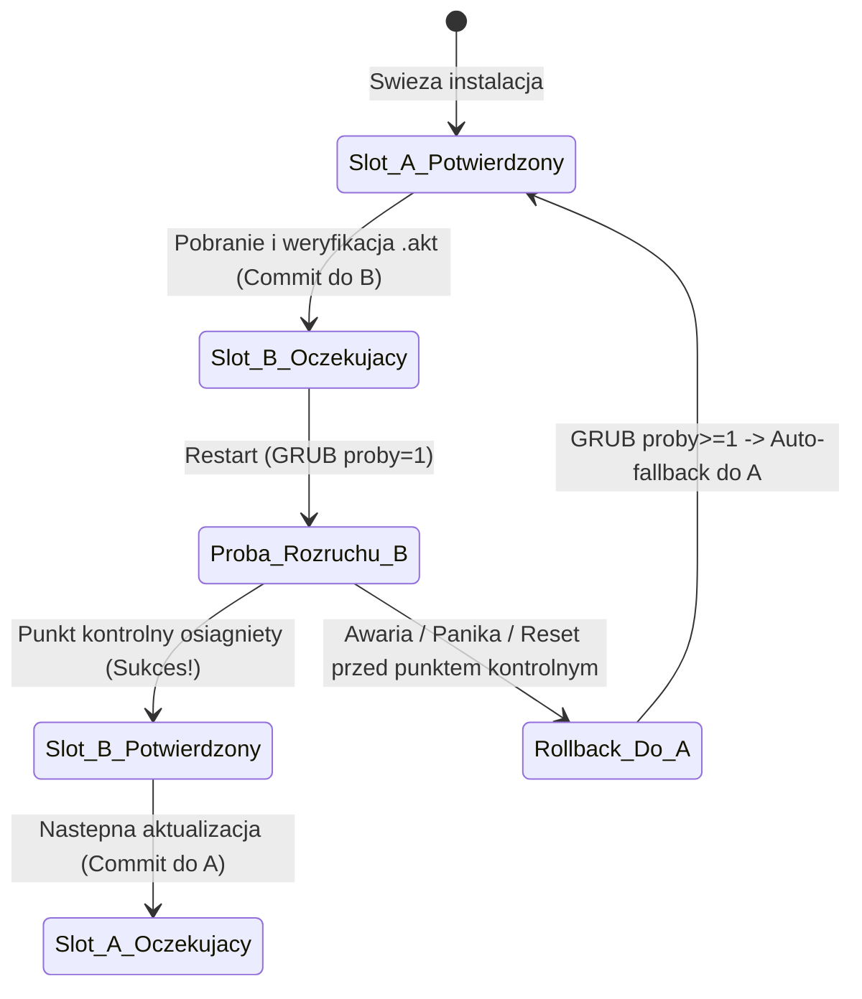

# Aktualizacja systemu Bursztyn OS

Dokument opisuje architekturę, układ partycji, mechanizm podwójnych slotów A/B, automat stanu rozruchu, procedury weryfikacji kryptograficznej oraz automatycznego wycofywania zmian (**rollback**) systemu operacyjnego Bursztyn OS.
Wszystkie nazwy użytkowe, ścieżki, statusy, komunikaty i formaty używają polskiego nazewnictwa.

> **Zasada rzetelności:** Niniejszy dokument opisuje wyłącznie funkcjonalności, które faktycznie istnieją w kodzie źródłowym, kompilują się z zerową liczbą ostrzeżeń (`-Wall -Wextra -Wpedantic`) i zostały w pełni zweryfikowane w testach jednostkowych oraz testach akceptacyjnych w emulatorze QEMU UEFI.

---

## 1. Architektura podwójnych slotów A/B i układ dysku

Bezpieczna aktualizacja OTA w Bursztyn OS opiera się na pełnej separacji slotu aktywnego (potwierdzonego) od slotu docelowego (nieaktywnego). System nigdy nie nadpisuje działającego jądra ani aktywnych plików systemowych w miejscu instalacji.

```
                    ┌────────────────────────────────────────────────────────┐
                    │                      DYSK SYSTEMOWY                    │
                    └────────────────────────────────────────────────────────┘
                       │                                                   │
     ┌─────────────────┴──────────────────┐             ┌──────────────────┴──────────────────┐
     ▼                                    ▼             ▼                                     ▼
┌─────────────────────────────┐  ┌──────────────────┐ ┌─────────────────────────────────────────┐
│     Partycja ESP (FAT32)    │  │  Sektory stanu   │ │          Partycja systemowa (BSP2)      │
│          (512 MiB)          │  │     rozruchu     │ │                                         │
├─────────────────────────────┤  ├──────────────────┤ ├─────────────────────────────────────────┤
│ /EFI/BOOT/BOOTX64.EFI       │  │ LBA 2046: Kopia 0│ │ /sloty/a/           /sloty/b/           │
│ /boot/jadro_a.bin   (Slot A)│  │ LBA 2047: Kopia 1│ │  ├── system/         ├── system/        │
│ /boot/jadro_b.bin   (Slot B)│  │ (512 B, CRC32,   │ │  │    └── jadro/     │    └── jadro/    │
│ /boot/grub/grub.cfg         │  │  generacja mon.) │ │  └── programy/       └── programy/      │
│ /boot/grub/grubenv  (1024 B)│  │                  │ │ ─────────────────────────────────────── │
│                             │  │                  │ │ Dane uzytkownika (wspolne, stale):      │
│                             │  │                  │ │ /uzytkownicy/   /dokumenty/   /obrazy/  │
└─────────────────────────────┘  └──────────────────┘ └─────────────────────────────────────────┘
```

### 1.1. Partycja rozruchowa ESP (FAT32, 512 MiB)
Partycja ESP sformatowana w standardzie FAT32 (klastry 4 KiB, 2 kopie tablicy FAT) zawiera:
- `/EFI/BOOT/BOOTX64.EFI` – bootloader GRUB x86_64-efi zbudowany samodzielnie (`grub-mkstandalone`) z wbudowanymi modułami `part_gpt`, `fat`, `loadenv`, `test`, `normal`, `multiboot2`.
- `/boot/jadro_a.bin` – jądro systemu dla Slotu A (obraz Multiboot2).
- `/boot/jadro_b.bin` – jądro systemu dla Slotu B (obraz Multiboot2).
- `/boot/grub/grub.cfg` – wbudowany skrypt wyboru slotu i obsługi powrotu.
- `/boot/grub/grubenv` – 1024-bajtowy blok środowiska GRUB przechowujący zmienne:
  - `bursztyn_potwierdzony=A|B` – aktualnie potwierdzony, stabilny slot rozruchowy.
  - `bursztyn_oczekujacy=BRAK|A|B|NIEUDANY` – slot oczekujący na pierwsze potwierdzenie rozruchu.
  - `bursztyn_proby=0|1` – licznik prób rozruchu slotu oczekującego.

### 1.2. Zarezerwowane sektory stanu rozruchu (Bursztyn Boot State reserved sectors: LBA 2046 i 2047)
W przestrzeni pomiędzy tablicą partycji GPT a początkiem pierwszej partycji (ESP na LBA 2048) zlokalizowane są dwa sektory fizyczne chronione sumą kontrolną:
- **LBA 2046:** Kopia 0 rekordu rozruchu (`bursztyn_rozruch_stan`).
- **LBA 2047:** Kopia 1 rekordu rozruchu (`bursztyn_rozruch_stan`).

Sektory te są **formalnie zarezerwowane** w specyfikacji układu dyskowego Bursztyn OS (`ROZRUCH_SEKTORY_NAZWA = "Bursztyn Boot State reserved sectors"`). **Nie wolno ich opisywać ani traktować jako zwykłej wolnej/nieużywanej przestrzeni dyskowej** (*unused free space*). Stanowią one autorytatywny, podwójny magazyn stanu rozruchu A/B, zabezpieczony przed kolizjami z metadanymi GPT oraz partycją ESP.

#### Audyt układu GPT i bezpieczeństwo alokacji sektorów LBA 2046/2047
1. **Położenie w strukturze dysku:**
   - Sektor 0: Protective MBR (PMBR).
   - Sektor 1: Nagłówek tablicy partycji GPT (Primary GPT Header).
   - Sektory 2–33: Tablica wpisów partycji GPT (Primary GPT Partition Array: 128 wpisów po 128 B = 32 sektory = 16 KiB).
   - Sektor 34: Pierwszy użyteczny sektor dysku (`FirstUsableLBA = 34`).
   - Sektory 34–2045: Obszar wyrównania partycji do granicy 1 MiB.
   - **Sektory 2046–2047: Formalnie zarezerwowane sektory stanu rozruchu Bursztyn OS (Bursztyn Boot State reserved sectors).**
   - Sektor 2048: Początek pierwszej partycji dysku (ESP FAT32, granica 1 MiB: 2048 * 512 B = 1 048 576 B).

2. **Analiza nakładania się (Overlap Analysis):**
   - **Brak kolizji z metadanymi GPT:** Podstawowa tablica partycji GPT kończy się na LBA 33. Sektory 2046 i 2047 znajdują się ponad 2000 sektorów (~1 MiB) za tablicą GPT.
   - **Brak kolizji z partycją ESP:** Partycja ESP rozpoczyna się ściśle od LBA 2048. Zapis w LBA 2046/2047 nie narusza sektora rozruchowego FAT32 (VBR), struktury FSInfo ani pierwszych klastrów ESP.
   - **Brak kolizji z systemem plików BSP2:** Partycja systemowa BSP2 znajduje się w przestrzeni powyżej 512 MiB (od LBA 1050624).
   - **Brak kolizji z zapasową tablicą GPT:** Kopia zapasowa GPT (Backup GPT Header i Partition Entries) znajduje się na samym końcu dysku (ostatnie 33 sektory).

3. **Wymogi i walidacja układu dyskowego przez instalator (Installer Disk-Layout Verification):**
   Przed sformatowaniem dysku i przed jakimkolwiek włączeniem mechanizmu A/B OTA, instalator oraz jądro wykonują ścisłą walidację układu nośnika (`Storage::rozruch_weryfikuj_uklad_dysku`):
   - **Brak kolizji z metadanymi GPT:** Tablica wpisów partycji GPT musi kończyć się ściśle przed LBA 2046 (`arr_end_lba < 2046`).
   - **Wyrównanie ESP:** Partycja ESP musi rozpoczynać się na lub za LBA 2048 (`esp.start >= 2048`, granica 1 MiB).
   - **Brak nachodzenia partycji:** Żadna partycja zadeklarowana w tablicy GPT nie może nachodzić na zarezerwowane sektory LBA 2046..2047.
   - **Obecność oczekiwanego układu Bursztyn OS:** Na dysku musi znajdować się partycja ESP (`EspType`) oraz partycja systemowa BSP (`BspType`).
   - **Zasada Fail-Closed:** Wykrycie jakiejkolwiek niezgodności natychmiast przerywa instalację z błędem krytycznym oraz blokuje aktywację A/B OTA.

4. **Status rezerwacji i plan rozwoju architektury GPT:**
   - W standardzie UEFI GPT zakres sektorów od `FirstUsableLBA` (34) do początku pierwszej zdefiniowanej partycji (2048) bywa przez zewnętrzne narzędzia formatujące traktowany jako przestrzeń nieprzydzielona. W systemie Bursztyn OS sektory LBA 2046 i LBA 2047 są ściśle chronione przed kolizjami przez instalator i procedury weryfikacyjne jądra.
   - **Uwaga dotycząca przyszłego rozwoju:** Przed stabilnym wydaniem publicznym lub przy kolejnej planowanej zmianie wersji układu GPT, w Bursztyn OS należy przeanalizować przeniesienie metadanych stanu rozruchu do małej, dedykowanej partycji GPT z unikalnym identyfikatorem GUID specyficznym dla Bursztyn OS (`BURSZTYN_BOOT_STATE_PARTITION_GUID = 6b84081c-99c0-4384-934d-175586616422`). Do tego czasu obecny model z formalnie zarezerwowanymi sektorami LBA 2046/2047 pozostaje niezmieniony, gdyż pomyślnie przeszedł wszystkie testy spójności i testy akceptacyjne QEMU bez wprowadzania niepotrzebnego ryzyka w instalatorze.

#### Format rekordu `bursztyn_rozruch_stan` (512 B, `__attribute__((packed))`)
- Magia nagłówka: `BURSZTYN_ROZRUCH_V1` (`0x53525542` / `0x31565A52`).
- Wersja formatu: `1`.
- Monotoniczny licznik generacji (64-bit): zwiększany przy każdym zapisie, zabezpieczający przed odczytem przestarzałych danych.
- Slot potwierdzony: `BURSZTYN_SLOT_A (0)` lub `BURSZTYN_SLOT_B (1)`.
- Slot oczekujący: `BURSZTYN_SLOT_NIEZNANY (0xFF)`, `BURSZTYN_SLOT_A (0)` lub `BURSZTYN_SLOT_B (1)`.
- Stan slotu oczekującego:
  - `BURSZTYN_STAN_NIEAKTYWNY (0)` – brak oczekującej aktualizacji.
  - `BURSZTYN_STAN_OCZEKUJACY (1)` – pakiet zainstalowany, oczekuje na pierwszy restart próbny.
  - `BURSZTYN_STAN_POTWIERDZONY (2)` – rozruch powiódł się i został zatwierdzony w punkcie kontrolnym.
  - `BURSZTYN_STAN_NIEUDANY (3)` – rozruch nie powiódł się; nastąpił automatyczny powrót (rollback).
- Licznik prób i limit prób: `licznik_prob`, `maks_prob = 1`.
- Wersja oczekująca i potwierdzona: trójka `major.minor.patch` (3 × 32-bit uint).
- Oczekiwana suma SHA-256 jądra: 32 bajty skrótu dla slotu A oraz dla slotu B.
- Suma kontrolna: 32-bitowe CRC32 (wielomian IEEE 802.3 `0xEDB88320`) wyliczane z pierwszych 508 bajtów struktury.

#### Rygorystyczna walidacja semantyczna
Weryfikacja rekordu (`rozruch_waliduj_rekord`) wykracza poza zwykłą sumę kontrolną CRC32 i bezwzględnie odrzuca sektory w przypadku:
1. Niezgodności magii lub nieobsługiwanej wersji formatu (`magic != ROZRUCH_MAGIC` lub `wersja != 1`).
2. Zerowej generacji (`generacja == 0`).
3. Nieprawidłowej wartości slotu (slot inny niż A, B lub NIEZNANY dla oczekującego).
4. Niemożliwej kombinacji slotów: `slot_oczekujacy == slot_potwierdzony`.
5. Niespójności stanu: slot oczekujący to NIEZNANY, ale stan to `OCZEKUJACY` lub `AKTYWNY`.
6. Niespójności stanu: slot oczekujący to A lub B, ale stan to `NIEAKTYWNY` lub `POTWIERDZONY`.
7. Nieprawidłowego licznika prób: `maks_prob != 1` lub `licznik_prob > maks_prob`.
8. Próby cofnięcia wersji (downgrade w stanie OCZEKUJACY): wersja oczekująca niższa lub równa wersji potwierdzonej (`oczekujaca <= potwierdzona`).
9. Wyzerowanego skrótu SHA-256 jądra oczekującego na uruchomienie.
10. Niezgodności sumy CRC32.

### 1.3. Partycja systemowa (BSP2) i translacja VFS
Partycja BSP2 zawiera jednolity system plików, w którym:
- Katalogi `/sloty/a` oraz `/sloty/b` przechowują niezależne drzewa plików systemowych (`/system/jadro/`, `/system/biblioteki/`, `/system/konfig/`, `/programy/`).
- Warstwa VFS w sterowniku PSF (`psf.cpp`, `rozwiaz_sciezke`) wykonuje transparentną translację w locie:
  - Gdy aktywny jest Slot A: zapytania o `/programy/...` lub `/system/...` są kierowane do `/sloty/a/programy/...` i `/sloty/a/system/...`.
  - Gdy aktywny jest Slot B: zapytania o `/programy/...` lub `/system/...` są kierowane do `/sloty/b/programy/...` i `/sloty/b/system/...`.
- Dane użytkownika (`/uzytkownicy/`, `/dokumenty/`, tapety, logi) znajdują się w korzeniu woluminu i **nie podlegają translacji ani nadpisywaniu podczas aktualizacji**. Użytkownik zachowuje wszystkie swoje pliki niezależnie od tego, który slot jest aktualnie uruchomiony.
- Kopia zapasowa stanu rozruchu w systemie plików: `/aktualizacje/stan_rozruchu.k0` oraz `/aktualizacje/stan_rozruchu.k1`.

---

## 2. Automat stanu i orkiestracja rozruchu

Automat stanu rozruchu gwarantuje, że nowy system zostanie uznany za sprawny wyłącznie wtedy, gdy pomyślnie uruchomi się i osiągnie pełną gotowość operacyjną.



### 2.1. Architektura prawdy: Autorytatywne sektory LBA 2046/2047 a bufor `grubenv`

W architekturze rozruchu Bursztyn OS istnieje ścisły, trójstopniowy podział ról:
1. **Autorytatywne źródło prawdy (Authoritative Source of Truth):**
   Sektory fizyczne LBA 2046 i LBA 2047 (wraz z lustrzanymi kopiami `/aktualizacje/stan_rozruchu.k0` i `.k1` na BSP2). To tutaj podejmowane i utrwalane są wszystkie decyzje o autoryzacji slotu, zatwierdzeniu nowej wersji, wersjach oprogramowania i sumach kontrolnych SHA-256 jąder.
2. **Mutowalny bufor rozruchowy fazy przedjądrowej (Derived Mutable Pre-boot Scratchpad):**
   Plik `/boot/grub/grubenv` na partycji ESP (FAT32). Jest to **jedyny zmienny nośnik stanu rozruchu przed załadowaniem jądra**. GRUB używa go do odczytu dyrektywy wyboru jądra oraz atomowej inkrementacji licznika prób rozruchu (`save_env bursztyn_proby`).
3. **Statyczny skrypt bootloadera (Immutable Embedded Script):**
   Skrypt `grub-embedded.cfg` jest statycznie wbudowany w obraz wykonywalny EFI (`BOOTX64.EFI`). Nie jest on mutowalnym buforem stanu – zawiera jedynie niezmienną logikę sprawdzania zmiennych z `grubenv` i ładowania odpowiedniego jądra Multiboot2.

| Cecha | Sektory fizyczne LBA 2046 / LBA 2047 (wraz z `/aktualizacje/stan_rozruchu.k0/k1`) | Blok środowiska `/boot/grub/grubenv` (FAT32 w ESP) |
|---|---|---|
| **Rola w systemie** | **Jedyna autorytatywna instancja prawdy (Authoritative Source of Truth)** | **Pochodny, mutowalny bufor rozruchowy (Derived Mutable Pre-boot Scratchpad)** |
| **Zarządca** | Jądro systemu Bursztyn OS | Bootloader GRUB oraz jądro systemu (samonaprawa) |
| **Kluczowe dane** | `slot_potwierdzony`, `slot_oczekujacy`, `stan_oczekujacego`, wersje, skróty SHA-256 jądra, generacja | `bursztyn_potwierdzony`, `bursztyn_oczekujacy`, `bursztyn_proby` |
| **Integralność** | 32-bitowe CRC32 + 10-punktowa walidacja semantyczna pól | Prosty tekstowy nagłówek blokowy `# GRUB Environment Block\n` |
| **Redundancja** | Podwójny sektor (ping-pong) + dwie kopie w systemie plików | Pojedynczy plik (1024 B) na partycji FAT32 |
| **Dostępność dla GRUB** | Niedostępne (GRUB nie parsuje struktur poza partycjami) | Odczytywane i zapisywane przez GRUB poleceniami `load_env` i `save_env` |

#### Dlaczego `grubenv` nie jest źródłem prawdy?
Bootloader GRUB na etapie startu UEFI dysponuje jedynie sterownikiem FAT32 i prostym mechanizmem zmiennych środowiskowych. Nie posiada wbudowanej wiedzy o semantyce wersji, skrótach SHA-256 jądra ani strukturach poza partycjami. Blok `grubenv` służy GRUB-owi wyłącznie do:
1. Podjęcia natychmiastowej decyzji, które jądro (`/boot/jadro_a.bin` czy `/boot/jadro_b.bin`) załadować do pamięci RAM.
2. Zinkrementowania licznika prób (`save_env bursztyn_proby`) zanim jądro zostanie uruchomione.

Wszelkie decyzje o prawomocności rozruchu, zatwierdzeniu nowej wersji i wycofaniu zmian podejmuje **wyłącznie jądro na podstawie autorytatywnych sektorów LBA 2046/2047**. W razie jakiejkolwiek niespójności jądro natychmiast przeprowadza samonaprawę `grubenv` lub odrzuca nieautoryzowany rozruch ze sprzętowym resetem.

### 2.2. Deterministyczny algorytm wyboru kopii LBA (Dual-Sector Selection)

Odczyt stanu rozruchu (`rozruch_wybierz_poprawna_kopie` / `wybierz_najlepsza_kopie`) analizuje obie kopie fizyczne (LBA 2046 oraz LBA 2047) według ścisłych reguł deterministycznych:

1. **Walidacja integralności i semantyki:**
   - Kopia 0 i Kopia 1 są poddawane weryfikacji CRC32 oraz sprawdzeniu semantycznemu (magia, wersja, poprawne identyfikatory slotów, brak niemożliwych kombinacji stanów).
   - Jeśli tylko jedna kopia jest poprawna, zostaje bezwzględnie wybrana (zapewnia to pełną tolerancję na uszkodzenie pojedynczego sektora lub awarię w trakcie zapisu).
   - Jeśli obie kopie są uszkodzone, system przechodzi w bezpieczny tryb awaryjny (domyślny Slot A jako potwierdzony).

2. **Porównanie generacji z arytmetyką modularną 64-bit (Counter Wrap):**
   - W przypadku, gdy obie kopie są poprawne, wybierana jest kopia o wyższej generacji monotonicznej.
   - Aby zapobiec błędom w skrajnym przypadku przekręcenia się 64-bitowego licznika generacji (`UINT64_MAX`), różnica generacji obliczana jest ze znakiem w przestrzeni liczb całkowitych:
     ```cpp
     int64_t diff = static_cast<int64_t>(k1->generacja - k0->generacja);
     if (diff > 0) return wybierz(k1);
     if (diff < 0) return wybierz(k0);
     ```

3. **Rozstrzyganie remisów przy równej generacji (Equal-Generation Tie-Breaking):**
   Gdy generacje obu poprawnych kopii są identyczne (co ma miejsce po pomyślnym zsynchronizowaniu obu sektorów), stosowane są twarde reguły preferencji bezpieczeństwa:
   - **Zasada ostrożności (Fail-Safe Priority):** Kopia oznaczona jako `BURSZTYN_STAN_NIEUDANY` ma bezwzględne pierwszeństwo przed kopią `BURSZTYN_STAN_OCZEKUJACY`. Zapobiega to ponawianiu rozruchu uszkodzonego slotu, jeśli jeden z sektorów został już oznaczony jako wycofany.
   - **Zasada stabilności:** Kopia o stabilnym stanie potwierdzonym bez oczekującego slotu ma pierwszeństwo przed kopią ze slotem oczekującym.
   - **Rozstrzygnięcie końcowe:** Jeśli parametry są identyczne lub symetryczne, deterministyczny remis rozstrzyga kopia wskazująca `SLOT_A`.

### 2.3. Kolejność zapisu fizycznego (Ping-Pong Write Ordering)

Aby zagwarantować, że w żadnym momencie awaria zasilania nie zniszczy jedynej poprawnej kopii stanu rozruchu, funkcja `Storage::rozruch_zapisz_sektory` stosuje strategię zapisu naprzemiennego (*ping-pong commit*):
1. **Analiza stanu przed zapisem:** Przed wykonaniem jakiegokolwiek zapisu sprawdzana jest poprawność i generacja sektorów aktualnie znajdujących się na dysku w LBA 2046 i LBA 2047.
2. **Zapis do sektora starszego lub uszkodzonego:**
   - Jeśli jeden z sektorów jest uszkodzony lub ma starszą generację, nowy rekord (z podbitą generacją i nowym CRC32) zapisywany jest **najpierw w miejsce tego starszego/uszkodzonego sektora**.
   - Wykonywany jest zrzut buforów kontrolera dyskowego (`flush`).
3. **Zapis do drugiego sektora:**
   - Dopiero po potwierdzeniu pomyślnego zapisu pierwszego sektora, identyczny rekord zapisywany jest do drugiego sektora.
   - Następuje ponowny zrzut buforów dysku.
4. **Zapis kopii w systemie plików i grubenv:**
   - Zapisywane są pliki `/aktualizacje/stan_rozruchu.k0` i `.k1`.
   - Na samym końcu zapisywany jest blok `/boot/grub/grubenv`.

### 2.4. Macierz rozwiązywania konfliktów i procedury samonaprawy (Conflict Resolution)

W przypadku rozbieżności pomiędzy autorytatywnymi sektorami LBA 2046/2047 a blokiem `grubenv` (np. wskutek utraty zasilania, uszkodzenia nośnika FAT32 lub manipulacji), system postępuje zgodnie z poniższą macierzą:

| Scenariusz awarii | Stan LBA 2046/2047 | Stan `grubenv` | Działanie systemu | Rezultat rozruchu i samonaprawa |
|---|---|---|---|---|
| **Zapis LBA powiódł się, zapis grubenv przerwany** | `potw=A`, `oczek=B`, `stan=OCZEKUJACY` | `bursztyn_potw=A`, `bursztyn_oczek=BRAK` | GRUB ładuje jądro A. Jądro A stwierdza, że jest potwierdzone. | Bezpieczny rozruch ze Slotu A. Aktualizacja oczekuje na ponowną aktywację. |
| **Zapis grubenv powiódł się, zapis LBA przerwany** | `potw=A`, `oczek=BRAK`, `stan=NIEAKTYWNY` | `bursztyn_potw=A`, `bursztyn_oczek=B` | GRUB ładuje jądro B. Jądro B czyta LBA i wykrywa brak autoryzacji! | **Odrzucenie nieautoryzowanego rozruchu.** Jądro B wymusza w `grubenv` powrót do A i wykonuje natychmiastowy reset. Następny rozruch ładuje A. |
| **LBA 2046 zaktualizowany, zasilanie utracone przed 2047** | LBA 2046: gen 2 (nowy), LBA 2047: gen 1 (stary) | `grubenv` stary lub nowy | Algorytm wyboru kopii wybiera LBA 2046 (wyższa generacja). | Prawidłowe odczytanie nowszego stanu. Przy kolejnym zapisie Kopia 1 jest automatycznie uzupełniana. |
| **Jeden z sektorów LBA uszkodzony (bad CRC)** | LBA 2046: uszkodzony, LBA 2047: poprawny | Zgodny z LBA 2047 | Algorytm wyboru kopii ignoruje uszkodzony LBA 2046 i ładuje LBA 2047. | Pełna ciągłość pracy; jądro samoczynnie odnawia uszkodzony sektor przy najbliższym zapisie. |
| **Blok `grubenv` brakujący lub wyzerowany** | LBA: poprawne (`potw=A`) | Brak pliku lub nagłówka | GRUB stosuje regułę fallback: ładuje `jadro_a.bin` (`bursztyn.slot=A`). | Jądro Slotu A wykrywa brak `grubenv` i **samoczynnie regeneruje poprawny blok `grubenv`** z danych LBA! |
| **Blok `grubenv` zawiera przedawniony stan (stale state)** | `potw=A`, `oczek=B`, `stan=NIEUDANY` | `bursztyn_potw=A`, `bursztyn_oczek=B` | GRUB ładuje jądro B. Jądro B widzi w LBA stan `NIEUDANY`. | **Odrzucenie rozruchu.** Jądro B zapisuje w `grubenv` status `NIEUDANY` i resetuje maszynę. GRUB ładuje A, a jądro A czyści `grubenv`. |

### 2.5. Rygorystyczna autoryzacja jądra (Unauthorized Boot Rejection)

Najważniejszą gwarancją bezpieczeństwa w Bursztyn OS jest zasada, że **samo uruchomienie jądra przez bootloader nie oznacza zgody na jego działanie**.

Podczas wczesnej fazy inicjalizacji funkcja `aktualizacja_sprawdz_rozruch(mbi)` weryfikuje zgodność uruchomionego slotu z autorytatywnym stanem w sektorach LBA:
1. **Rozruch potwierdzony:** Jeśli uruchomiony slot zgadza się ze `stan.slot_potwierdzony`, jądro kontynuuje normalny start, a w razie potrzeby naprawia uszkodzony plik `grubenv`.
2. **Autoryzowany rozruch próbny:** Jeśli uruchomiony slot zgadza się ze `stan.slot_oczekujacy` i w LBA pole `stan_oczekujacego` ma dokładnie wartość `BURSZTYN_STAN_OCZEKUJACY`, a licznik prób nie przekroczył limitu, jądro rozpoczyna fazę weryfikacji zdrowia systemu.
3. **Nieautoryzowany rozruch (Critical Security Violation):**
   Jeśli jądro wykryje, że zostało załadowane mimo braku potwierdzenia i braku autoryzacji oczekującej w LBA (np. z powodu zmanipulowanego lub przedawnionego pliku `grubenv`):
   - Jądro rejestruje komunikaty ostrzegawcze:
     ```
     [ROZRUCH] BLAD KRYTYCZNY: Nieautoryzowany rozruch slotu!
     [ROZRUCH] Odrzucenie na podstawie kanonicznych sektorow stanu rozruchu.
     [ROZRUCH] Natychmiastowy powrot do potwierdzonego slotu.
     ```
   - Nadpisuje blok `grubenv` na partycji ESP, wymuszając powrót do slotu potwierdzonego:
     ```
     bursztyn_potwierdzony=<POTWIERDZONY>
     bursztyn_oczekujacy=NIEUDANY
     bursztyn_proby=0
     ```
   - Wyłącza przerwania (`cli`) i natychmiast wysyła sprzętowe polecenie resetu do kontrolera klawiatury standardu PC (`outb $0xFE, $0x64`), uniemożliwiając wykonanie jakichkolwiek dalszych procesów użytkownika.

### 2.6. Skrypt rozruchowy GRUB (`grub-embedded.cfg`)
Bootloader GRUB wykonuje następującą sekwencję przy każdym włączeniu komputera:
1. Wczytuje blok zmiennych z `/boot/grub/grubenv` przy użyciu polecenia `load_env`.
2. Sprawdza poprawność zmiennej `bursztyn_potwierdzony` (awaryjny domyślny fallback na `A` w przypadku braku lub uszkodzenia pliku).
3. Sprawdza obecność slotu oczekującego (`bursztyn_oczekujacy` równe `A` lub `B`):
   - **Gdy `bursztyn_proby == 0` (pierwsza próba):**
     - Ustawia `bursztyn_proby="1"`.
     - Zapisuje licznik na dysk poleceniem `save_env bursztyn_proby`.
     - Wybiera jądro slotu oczekującego (`/boot/jadro_b.bin` lub `/boot/jadro_a.bin`).
     - Przekazuje w linii poleceń Multiboot2 parametr `bursztyn.slot=B` (lub `A`).
   - **Gdy `bursztyn_proby > 0` (próba wyczerpana po resecie lub awarii):**
     - Oznacza slot jako nieudany: `bursztyn_oczekujacy="NIEUDANY"`.
     - Zapisuje zmianę: `save_env bursztyn_oczekujacy`.
     - **Automatycznie wycofuje rozruch (rollback)** do slotu potwierdzonego: uruchamia jądro potwierdzone z parametrem `bursztyn.slot=A` (lub `B`).

### 2.2. Punkt kontrolny w jądrze (Health Checkpoint)
Jądro nie potwierdza rozruchu natychmiast po załadowaniu do pamięci. Potwierdzenie rozruchu (`aktualizacja_potwierdz_rozruch()`) następuje dopiero w punkcie kontrolnym po:
1. Pomyślnej inicjalizacji pamięci fizycznej (PMM) i tablic stronicowania (VMM).
2. Wykryciu urządzeń blokowych AHCI i zweryfikowaniu partycji systemowej BSP2.
3. Włączeniu translacji slotów PSF dla uruchomionego slotu (`psf_ustaw_aktywny_slot`).
4. Zainicjalizowaniu podsystemu grafiki GOP / Bochs VBE i buforów ramki.
5. Pomyślnym załadowaniu i uruchomieniu Menedżera Okien oraz powłoki systemowej.
6. Uruchomieniu wielozadaniowego schedulera Round-Robin i zalogowaniu komunikatu `System operacyjny gotowy!`.

Dopiero w tym momencie jądro wykonuje:
- Uaktualnienie sektorów LBA 2046/2047: `slot_potwierdzony = aktywny`, `slot_oczekujacy = NIEZNANY`, `stan_oczekujacego = POTWIERDZONY`, `licznik_prob = 0`, inkrementacja generacji monotonicznej, przeliczenie CRC32.
- Zapis lustrzanych kopii w systemie plików: `/aktualizacje/stan_rozruchu.k0` i `.k1`.
- Zapis bloku `grubenv`: `bursztyn_potwierdzony=<NOWY>`, `bursztyn_oczekujacy=BRAK`, `bursztyn_proby=0`.
- Zalogowanie do konsoli i logów: `[ROZRUCH] Slot B potwierdzony.`

### 2.3. Automatyczny powrót (Rollback) po nieudanym rozruchu
Jeśli nowe jądro ulegnie panice, zawieszeniu, przerwaniu zasilania lub pętli restartu przed osiągnięciem punktu kontrolnego:
1. Kolejny rozruch maszyny powoduje wczytanie GRUB-a z `bursztyn_proby=1`.
2. GRUB wykrywa wyczerpanie limitu prób, ustawia `bursztyn_oczekujacy=NIEUDANY` i bez jakiejkolwiek interwencji użytkownika ładuje poprzednie, potwierdzone jądro (`jadro_a.bin`).
3. Działające jądro A podczas startu wykrywa nieudany rozruch w `grubenv` / sektorach rozruchu:
   - Rejestruje zdarzenie w logach systemowych:
     `[ROZRUCH] Nieudane uruchomienie slotu B.`
     `[ROZRUCH] Powrot do slotu A.`
   - Oznacza slot B jako `BURSZTYN_STAN_NIEUDANY` w sektorach LBA 2046/2047.
   - Czyści stan w `grubenv` (`bursztyn_oczekujacy=BRAK`, `bursztyn_proby=0`).
   - System pozostaje w pełni sprawny, a użytkownik może normalnie pracować.

---

## 3. Pełny proces aktualizacji (Krok po kroku)

Poniższy diagram przedstawia pełny cykl życia aktualizacji:

```
[1. Wykrycie]     Pobranie manifestu wykazaktualizacji.wykaz
                        │
                        ▼
[2. Weryfikacja]   Sprawdzenie struktury, granic i podpisu cyfrowego RSA-2048 wykazu
                        │ (błąd = natychmiastowe przerwanie, brak zmian na dysku)
                        ▼
[3. Wersje]        Sprawdzenie numeryczne: docelowa > obecna oraz obecna >= minimalna
                        │ (ochrona przed downgrade - pakiety starsze/równe są odrzucane)
                        ▼
[4. Wybór slotu]   Odczyt aktywnego slotu (np. A) ──> Wybór slotu nieaktywnego jako celu (B)
                        │ (wykrycie starego układu bez /sloty = fail-closed)
                        ▼
[5. Pobieranie]    Pobranie pakietu bursztyn-X.Y.Z.akt do /aktualizacje/pobieranie.tmp
                        │
                        ▼
[6. Sprawdzenie]   Sprawdzenie magii BAKT, allowlisty kategorii, sumy SHA-256 pakietu
                   oraz sum SHA-256 poszczególnych wpisów
                        │
                        ▼
[7. Staging]       Rozpakowanie wpisów do /aktualizacje/przygotowanie/<kat>_<sciezka>
                   z natychmiastowym odczytem kontrolnym i weryfikacją SHA-256
                        │
                        ▼
[8. Commit do B]   Kopiowanie plików do NIEAKTYWNEGO slotu (/sloty/b/...)
                   + Zapis jądra na partycję ESP (/boot/jadro_b.bin)
                   + Odczyt kontrolny z ESP i weryfikacja SHA-256 jądra
                   + Zapis wersji do /sloty/b/system/wersja
                   + psf_flush_cache()
                        │ (Slot A pozostaje w 100% nienaruszony!)
                        ▼
[9. Aktywacja]     Zapis stanu oczekującego do LBA 2046/2047 (CRC32, nowa generacja)
                   + Zapis stanu do /aktualizacje/stan_rozruchu.k0 i .k1
                   + Zapis bloku grubenv (potwierdzony=A, oczekujacy=B, proby=0)
                   + Log: [AKTUALIZACJA] Slot B oczekuje na uruchomienie.
                   + Log: [AKTUALIZACJA] Wymagane ponowne uruchomienie.
                        │
                        ▼
[10. Restart]      Restart systemu ──> GRUB proby=1 ──> Start Slotu B
                        │
            ┌───────────┴───────────┐
            ▼                       ▼
    [Sukces Slotu B]        [Awaria Slotu B]
  Punkt kontrolny         Przerwanie przed gotowością
            │                       │
            ▼                       ▼
  Potwierdzenie:          Kolejny restart:
  LBA 2046/2047: potw=B   GRUB: wyczerpane próby
  grubenv: potw=B, oczek=BRAK  Auto-boot Slotu A (Rollback)
  [ROZRUCH] Slot B potwierdzony.  [ROZRUCH] Powrot do slotu A.
```

---

## 4. Bezpieczeństwo i odporność na awarie

### 4.1. Odporność na zaniki zasilania i rozszczepione zapisy (Torn-Writes)
W każdej fazie procesu aktualizacji system gwarantuje integralność danych:

1. **Zanik zasilania podczas pobierania lub weryfikacji:**
   Plik `/aktualizacje/pobieranie.tmp` jest plikiem tymczasowym. Żadne pliki systemowe ani sektory rozruchu nie są zmieniane. Po restarcie plik tymczasowy jest ignorowany lub czyszczony.
2. **Zanik zasilania podczas instalacji plików do slotu nieaktywnego:**
   Slot aktywny (np. A) nie jest w ogóle modyfikowany. Nawet jeśli zapis do slotu B zostanie przerwany w połowie, stan rozruchu w LBA 2046/2047 oraz `grubenv` nadal wskazują wyłącznie slot A jako potwierdzony. System startuje ze slotu A bez jakichkolwiek zakłóceń.
3. **Zanik zasilania podczas zapisu jądra na ESP:**
   Jądro zapisywane jest do nieaktywnego pliku (`jadro_b.bin`). Aktywne jądro (`jadro_a.bin`) pozostaje w 100% nienaruszone.
4. **Zanik zasilania podczas zapisu sektorów rozruchu (LBA 2046 / LBA 2047):**
   Sektory są zapisywane sekwencyjnie. Jeśli zasilanie zostanie odcięte podczas zapisu LBA 2046, jego suma CRC32 będzie niepoprawna. Podczas startu algorytm `rozruch_wybierz_poprawna_kopie()` wykryje błąd CRC kopii 0 i bezbłędnie załaduje kopię 1 (LBA 2047). Jeśli obie kopie są poprawne, wybierana jest kopia o wyższym liczniku generacji.
5. **Zanik zasilania podczas zapisu `grubenv`:**
   Skrypt rozruchowy GRUB posiada twarde zabezpieczenie awaryjne (`unconditional recovery fallback`): jeśli zmienna `bursztyn_potwierdzony` nie jest poprawną wartością `A` ani `B`, przyjmuje bezpieczną wartość domyślną `A`.
6. **Zanik zasilania lub awaria podczas rozruchu nowego slotu:**
   Licznik prób w `grubenv` został ustawiony na 1 przed startem jądra. Przy kolejnym włączeniu zasilania GRUB stwierdza `bursztyn_proby >= 1`, rezygnuje z ponownego uruchamiania uszkodzonego slotu i natychmiast wraca do slotu potwierdzonego.

### 4.2. Rozgraniczenie ochrony przed downgrade a powrotu (Rollback)
W systemie obowiązuje ścisłe rozróżnienie dwóch pojęć:
- **Niedozwolony Downgrade OTA:**
  Zdalny pakiet aktualizacji (`.akt`) o wersji niższej lub równej bieżącej wersji w `/system/wersja` jest **bezwzględnie odrzucany** na poziomie logiki jądra (`akt_czy_dozwolona_aktualizacja`). Niemożliwe jest celowe wstrzyknięcie starszego, podatnego na błędy pakietu aktualizacji.
- **Dozwolony i gwarantowany Rollback:**
  Wycofanie do poprzedniej, w pełni potwierdzonej wersji systemu w przypadku nieudanego rozruchu nowo zainstalowanego slotu jest **w pełni dozwolone i automatyczne**. Stanowi ono fundament niezawodności i ochrony przed unieruchomieniem urządzenia (*anti-bricking*).

### 4.3. Zaufanie kryptograficzne i separacja kluczy
Podsystem aktualizacji korzysta z wbudowanego w jądro klucza publicznego RSA-2048 z dopełnieniem PKCS#1 v1.5 i skrótem SHA-256:
- **Klucz wydania (RELEASE):**
  - Osadzony domyślnie w kompilacji wydaniowej (`make`, `make iso`).
  - Odcisk SHA-256 (DER): `aceba052f909631385b44e41468093b82cc27e109f979ec6d09b56ac743f2d86`.
  - Pakiety podpisane kluczem testowym są w tym trybie **bezwzględnie odrzucane**.
- **Klucz testowy (TEST):**
  - Wykorzystywany wyłącznie w automatycznych testach deweloperskich i środowiskach CI.
  - Odcisk SHA-256 (DER): `fffdeebb5ef23df60b8a04598fec9b1eaa8a7191cdec2fe0ff9e37a869297265`.
- Prywatny klucz wydania nigdy nie znajduje się w repozytorium ani na serwerach sieciowych; znajduje się w odizolowanym magazynie kluczy (*air-gap*).

---

## 5. Procedura testowania

Mechanizm aktualizacji posiada pełne pokrycie testami automatycznymi na trzech poziomach:

### 5.1. Testy formatów i parsera (`make test-aktualizacje`)
Weryfikacja 40 testów parsera C++ oraz 33 testów integracyjnych weryfikujących podpis RSA, integralność SHA-256, odrzucanie traversalów ścieżek i odporność sieciową:
```bash
make test-aktualizacje
```

### 5.2. Testy jednostkowe automatu stanu rozruchu (`make test-rozruch`)
Kompletny zestaw 52 rygorystycznych testów jednostkowych i symulacji awarii weryfikujący odporność na utratę zasilania, błędy zapisu i niezgodności:
```bash
make test-rozruch
```
Zakres pokrytych scenariuszy (52/52 PASS):
1. Świeża instalacja (Slot A potwierdzony, Slot B nieaktywny).
2. Początkowy stan sektorów LBA 2046/2047 i bloku `grubenv`.
3. Poprawna instalacja aktualizacji ze Slotu A do Slotu B.
4. Potwierdzenie rozruchu Slotu B w punkcie kontrolnym.
5. Druga aktualizacja ze Slotu B do Slotu A.
6. Automatyczny rollback z nieudanego Slotu B do Slotu A.
7. Automatyczny rollback z nieudanego Slotu A do Slotu B.
8. Obsługa uszkodzonego nagłówka stanu rozruchu.
9. Uszkodzenie jednej kopii (LBA 2046) – automatyczny wybór poprawnej kopii (LBA 2047).
10. Uszkodzenie obu kopii sektorów – bezpieczny fallback do stanu początkowego.
11. Brak jądra w slocie oczekującym – odrzucenie rozruchu.
12. Niezgodność skrótu SHA-256 jądra na ESP – natychmiastowe odrzucenie.
13. Niezgodność wersji w metadanych jądra.
14. Utrata zasilania przed oznaczeniem slotu oczekującego.
15. Utrata zasilania w trakcie zapisu sektorów oczekujących.
16. Utrata zasilania po zapisaniu slotu oczekującego.
17. Utrata zasilania przed potwierdzeniem rozruchu.
18. Utrata zasilania w trakcie zapisu potwierdzenia.
19. Wyczerpanie limitu prób rozruchu (licznik prób >= 1).
20. Próba instalacji pakietu o wersji niższej lub równej (downgrade) – odrzucenie.
21. Zezwolenie na automatyczny powrót do starszej wersji potwierdzonej po awarii rozruchu.
22. Próba nadpisania aktualnie aktywnego slotu – odrzucenie.
23. Odrzucenie uszkodzonego pakietu `.akt`.
24. Odrzucenie nieprawidłowego podpisu cyfrowego.
25. Odrzucenie pakietu podpisanego kluczem testowym w kompilacji RELEASE.
26. Niezmiennik dysku wartowniczego (sentinel) – brak jakichkolwiek modyfikacji poza wyznaczonymi granicami.
27. Sukces zapisu LBA przy niepowodzeniu zapisu `grubenv` (LBA succeeds / grubenv fails).
28. Sukces zapisu `grubenv` przy niepowodzeniu zapisu LBA (grubenv succeeds / LBA fails).
29. LBA 2046 zaktualizowany, utrata zasilania przed zapisem LBA 2047.
30. LBA 2047 zaktualizowany, LBA 2046 pozostaje w wersji poprzedniej.
31. Uszkodzenie fizyczne jednego sektora rozruchu (CRC error).
32. Różne poprawne generacje w obu sektorach – deterministyczny wybór nowszej.
33. Równe generacje z różnymi danymi – deterministyczne rozstrzygnięcie remisu (tie-breaking).
34. Zawinięcie 64-bitowego licznika generacji (modular 64-bit counter wrap).
35. Całkowity brak pliku `grubenv` (missing grubenv) – awaryjny fallback do Slotu A.
36. Obcięty plik `grubenv` (truncated grubenv) – awaryjny fallback do Slotu A.
37. Uszkodzona zawartość pliku `grubenv` (corrupted grubenv) – awaryjny fallback do Slotu A.
38. Przedawniony stan w `grubenv` (stale state) – odrzucenie przez autorytatywne LBA.
39. Poprawne CRC przy semantycznie nieprawidłowym identyfikatorze slotu – odrzucenie.
40. Poprawne CRC przy nieprawidłowej wartości licznika prób – odrzucenie.
41. Poprawne CRC przy niemożliwym stanie: `slot_oczekujacy == slot_potwierdzony` – odrzucenie.
42. Poprawne CRC przy niemożliwym stanie: `slot_oczekujacy == NIEZNANY` ze statusem `OCZEKUJACY` – odrzucenie.
43. Poprawne CRC przy niemożliwym stanie: `slot_oczekujacy != NIEZNANY` ze statusem `NIEAKTYWNY` – odrzucenie.
44. Poprawne CRC przy niemożliwym stanie: status `POTWIERDZONY` przy obecnym slocie oczekującym – odrzucenie.
45. Poprawne CRC przy zerowej generacji (`generacja == 0`) – odrzucenie.
46. Poprawne CRC przy próbie downgrade wersji w stanie oczekującym – odrzucenie.
47. Utrata zasilania we wszystkich podfazach aktywacji slotu oczekującego.
48. Utrata zasilania podczas inkrementacji licznika prób rozruchu przez GRUB.
49. Utrata zasilania podczas potwierdzania nowego slotu w punkcie kontrolnym.
50. Utrata zasilania podczas procedury wycofywania zmian (rollback).
51. Gwarancja nienaruszalności danych użytkownika (`/uzytkownicy/`, dokumenty, obrazy).
52. Niezmiennik nienaruszalności dysku wartowniczego w całym cyklu testowym.

### 5.3. Kompleksowy test akceptacyjny w QEMU UEFI (`make test-rozruch-qemu`)
Pełny test end-to-end w wirtualnej maszynie QEMU z oprogramowaniem układowym OVMF UEFI:
```bash
make test-rozruch-qemu
```
Przebieg pełnego 9-etapowego testu akceptacyjnego:
1. **Instalacja systemu:** Uruchomienie instalatora graficznego z obrazu ISO i instalacja systemu na wirtualnym dysku SATA AHCI.
2. **Weryfikacja stanu początkowego:** Sprawdzenie spójności LBA 2046/2047, `grubenv` oraz hasha dysku wartowniczego.
3. **Rozruch ze Slotu A:** Start zainstalowanego jądra ze Slotu A, osiągnięcie gotowości operacyjnej i pulpitu.
4. **Instalacja i oznaczenie Slotu B:** Zastosowanie aktualizacji do Slotu B jako oczekującego na rozruch.
5. **Rozruch próbny Slotu B i potwierdzenie:** Start jądra B, osiągnięcie punktu kontrolnego i zatwierdzenie Slotu B w LBA i `grubenv`.
6. **Weryfikacja trwałości:** Restart systemu i potwierdzenie, że maszyna trwale startuje ze Slotu B.
7. **Test awarii i automatyczny powrót (Rollback):** Celowa kontrolowana awaria Slotu B przed punktem kontrolnym; wykrycie wyczerpania prób przez GRUB i automatyczny powrót do Slotu A.
8. **Test rozszczepionego zapisu (Split-Write):** Utrata zasilania po zapisie LBA, ale przed zapisem `grubenv`; bezpieczny rozruch potwierdzonego slotu A.
9. **Samonaprawa (Self-Healing) i odrzucenie nieautoryzowanego rozruchu:**
   - Celowe wyzerowanie `grubenv` na ESP -> GRUB ładuje fallback, a jądro ze Slotu A samoczynnie regeneruje `grubenv` z sektorów LBA.
   - Wstrzyknięcie zmanipulowanego `grubenv` nakazującego start B, gdy LBA oznacza B jako `NIEUDANY` -> jądro B natychmiast odrzuca rozruch na podstawie LBA, naprawia `grubenv` i wykonuje sprzętowy reset powrotny do A.
   - Weryfikacja nienaruszalności dysku wartowniczego (identyczny skrót SHA-256 przed i po wszystkich 9 etapach).

---

## 6. Status techniczny i zgodność

```
A/B UPDATE SLOTS IMPLEMENTED
BOOT INTO UPDATED SYSTEM VERIFIED IN QEMU
BOOT SUCCESS CONFIRMATION VERIFIED
AUTOMATIC ROLLBACK VERIFIED IN QEMU
FAILED UPDATE PRESERVES CONFIRMED SLOT
TEST KEY REJECTED BY RELEASE BUILD
LBA 2046/2047 AUTHORITATIVE STORE VERIFIED
CONFLICT RESOLUTION AND SELF-HEALING VERIFIED IN QEMU
UNAUTHORIZED BOOT REJECTION AND HARDWARE RESET VERIFIED
52/52 UNIT TESTS PASSING
NOT MANUALLY VERIFIED ON REAL HARDWARE
```
