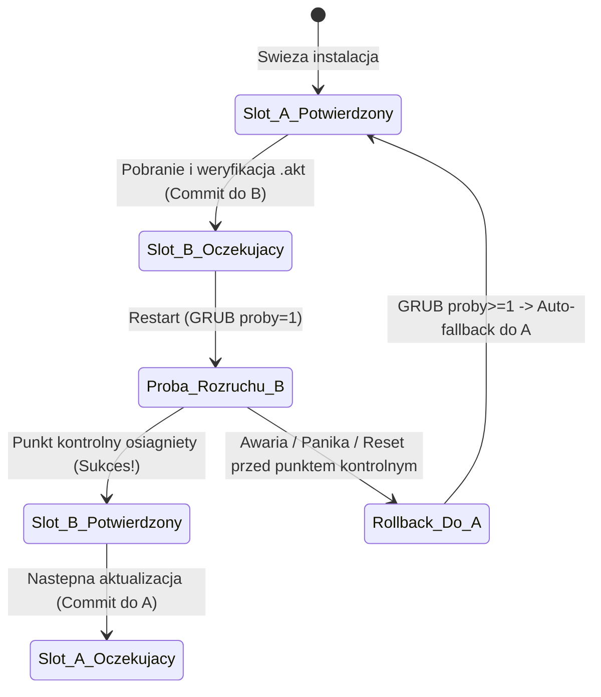

# Aktualizacja systemu Bursztyn OS

Dokument opisuje architekturę, układ partycji, mechanizm podwójnych slotów A/B, automat stanu rozruchu, procedury weryfikacji kryptograficznej oraz automatycznego wycofywania zmian (**rollback**) systemu operacyjnego Bursztyn OS.
Wszystkie nazwy użytkowe, ścieżki, statusy, komunikaty i formaty używają polskiego nazewnictwa.

> **Zasada rzetelności:** Niniejszy dokument opisuje wyłącznie funkcjonalności, które faktycznie istnieją w kodzie źródłowym, kompilują się z zerową liczbą ostrzeżeń (`-Wall -Wextra -Wpedantic`) i zostały w pełni zweryfikowane w testach jednostkowych oraz testach akceptacyjnych w emulatorze QEMU UEFI.

---

## 1. Architektura podwójnych slotów A/B i układ dysku

Bezpieczna aktualizacja OTA w Bursztyn OS opiera się na pełnej separacji slotu aktywnego (potwierdzonego) od slotu docelowego (nieaktywnego). System nigdy nie nadpisuje działającego jądra ani aktywnych plików systemowych w miejscu instalacji.

```
                    ┌────────────────────────────────────────────────────────┐
                    │                      DYSK SYSTEMOWY                    │
                    └────────────────────────────────────────────────────────┘
                       │                                                   │
     ┌─────────────────┴──────────────────┐             ┌──────────────────┴──────────────────┐
     ▼                                    ▼             ▼                                     ▼
┌─────────────────────────────┐  ┌──────────────────┐ ┌─────────────────────────────────────────┐
│     Partycja ESP (FAT32)    │  │  Sektory stanu   │ │          Partycja systemowa (BSP2)      │
│          (512 MiB)          │  │     rozruchu     │ │                                         │
├─────────────────────────────┤  ├──────────────────┤ ├─────────────────────────────────────────┤
│ /EFI/BOOT/BOOTX64.EFI       │  │ LBA 2046: Kopia 0│ │ /sloty/a/           /sloty/b/           │
│ /boot/jadro_a.bin   (Slot A)│  │ LBA 2047: Kopia 1│ │  ├── system/         ├── system/        │
│ /boot/jadro_b.bin   (Slot B)│  │ (512 B, CRC32,   │ │  │    └── jadro/     │    └── jadro/    │
│ /boot/grub/grub.cfg         │  │  generacja mon.) │ │  └── programy/       └── programy/      │
│ /boot/grub/grubenv  (1024 B)│  │                  │ │ ─────────────────────────────────────── │
│                             │  │                  │ │ Dane uzytkownika (wspolne, stale):      │
│                             │  │                  │ │ /uzytkownicy/   /dokumenty/   /obrazy/  │
└─────────────────────────────┘  └──────────────────┘ └─────────────────────────────────────────┘
```

### 1.1. Partycja rozruchowa ESP (FAT32, 512 MiB)
Partycja ESP sformatowana w standardzie FAT32 (klastry 4 KiB, 2 kopie tablicy FAT) zawiera:
- `/EFI/BOOT/BOOTX64.EFI` – bootloader GRUB x86_64-efi zbudowany samodzielnie (`grub-mkstandalone`) z wbudowanymi modułami `part_gpt`, `fat`, `loadenv`, `test`, `normal`, `multiboot2`.
- `/boot/jadro_a.bin` – jądro systemu dla Slotu A (obraz Multiboot2).
- `/boot/jadro_b.bin` – jądro systemu dla Slotu B (obraz Multiboot2).
- `/boot/grub/grub.cfg` – wbudowany skrypt wyboru slotu i obsługi powrotu.
- `/boot/grub/grubenv` – 1024-bajtowy blok środowiska GRUB przechowujący zmienne:
  - `bursztyn_potwierdzony=A|B` – aktualnie potwierdzony, stabilny slot rozruchowy.
  - `bursztyn_oczekujacy=BRAK|A|B|NIEUDANY` – slot oczekujący na pierwsze potwierdzenie rozruchu.
  - `bursztyn_proby=0|1` – licznik prób rozruchu slotu oczekującego.

### 1.2. Sektory stanu rozruchu poza partycjami (LBA 2046 i 2047)
W 1 MiB przerwy technicznej tablicy GPT przed pierwszą partycją (zaczynającą się od LBA 2048) alokowane są dwa sektory fizyczne chronione sumą kontrolną:
- **LBA 2046:** Kopia 0 rekordu rozruchu (`bursztyn_rozruch_stan`).
- **LBA 2047:** Kopia 1 rekordu rozruchu (`bursztyn_rozruch_stan`).

Format rekordu (dokładnie 512 bajtów, upakowany `__attribute__((packed))`):
- Magia nagłówka: `BURSZTYN_ROZRUCH_V1` (`0x53525542` / `0x31565A52`).
- Wersja formatu: `1`.
- Monotoniczny licznik generacji (64-bit): rosnący przy każdym zapisie, zabezpieczający przed odczytem przestarzałych danych.
- Slot potwierdzony: `BURSZTYN_SLOT_A (0)` lub `BURSZTYN_SLOT_B (1)`.
- Slot oczekujący: `BURSZTYN_SLOT_NIEZNANY (0xFF)`, `BURSZTYN_SLOT_A (0)` lub `BURSZTYN_SLOT_B (1)`.
- Stan slotu oczekującego:
  - `BURSZTYN_STAN_NIEAKTYWNY (0)` – brak oczekującej aktualizacji.
  - `BURSZTYN_STAN_OCZEKUJACY (1)` – pakiet zainstalowany, oczekuje na pierwszy restart.
  - `BURSZTYN_STAN_POTWIERDZONY (2)` – rozruch powiódł się i został zatwierdzony w punkcie kontrolnym.
  - `BURSZTYN_STAN_NIEUDANY (3)` – rozruch nie powiódł się; nastąpił powrót (rollback).
- Licznik prób i limit prób: `licznik_prob`, `maks_prob = 1`.
- Numeryczna wersja oczekująca i potwierdzona: `major.minor.patch`.
- Oczekiwana suma SHA-256 jądra: 32 bajty skrótu.
- Suma kontrolna: 32-bitowe CRC32 (wielomian IEEE 802.3 `0xEDB88320`) wyliczane z pierwszych 508 bajtów struktury.

### 1.3. Partycja systemowa (BSP2) i translacja VFS
Partycja BSP2 zawiera jednolity system plików, w którym:
- Katalogi `/sloty/a` oraz `/sloty/b` przechowują niezależne drzewa plików systemowych (`/system/jadro/`, `/system/biblioteki/`, `/system/konfig/`, `/programy/`).
- Warstwa VFS w sterowniku PSF (`psf.cpp`, `rozwiaz_sciezke`) wykonuje transparentną translację w locie:
  - Gdy aktywny jest Slot A: zapytania o `/programy/...` lub `/system/...` są kierowane do `/sloty/a/programy/...` i `/sloty/a/system/...`.
  - Gdy aktywny jest Slot B: zapytania o `/programy/...` lub `/system/...` są kierowane do `/sloty/b/programy/...` i `/sloty/b/system/...`.
- Dane użytkownika (`/uzytkownicy/`, `/dokumenty/`, tapety, logi) znajdują się w korzeniu woluminu i **nie podlegają translacji ani nadpisywaniu podczas aktualizacji**. Użytkownik zachowuje wszystkie swoje pliki niezależnie od tego, który slot jest aktualnie uruchomiony.
- Kopia zapasowa stanu rozruchu w systemie plików: `/aktualizacje/stan_rozruchu.k0` oraz `/aktualizacje/stan_rozruchu.k1`.

---

## 2. Automat stanu i orkiestracja rozruchu

Automat stanu rozruchu gwarantuje, że nowy system zostanie uznany za sprawny wyłącznie wtedy, gdy pomyślnie uruchomi się i osiągnie pełną gotowość operacyjną.



### 2.1. Skrypt rozruchowy GRUB (`grub-embedded.cfg`)
Bootloader GRUB wykonuje następującą sekwencję przy każdym włączeniu komputera:
1. Wczytuje blok zmiennych z `/boot/grub/grubenv` przy użyciu polecenia `load_env`.
2. Sprawdza poprawność zmiennej `bursztyn_potwierdzony` (awaryjny domyślny fallback na `A` w przypadku braku lub uszkodzenia pliku).
3. Sprawdza obecność slotu oczekującego (`bursztyn_oczekujacy` równe `A` lub `B`):
   - **Gdy `bursztyn_proby == 0` (pierwsza próba):**
     - Ustawia `bursztyn_proby="1"`.
     - Zapisuje licznik na dysk poleceniem `save_env bursztyn_proby`.
     - Wybiera jądro slotu oczekującego (`/boot/jadro_b.bin` lub `/boot/jadro_a.bin`).
     - Przekazuje w linii poleceń Multiboot2 parametr `bursztyn.slot=B` (lub `A`).
   - **Gdy `bursztyn_proby > 0` (próba wyczerpana po resecie lub awarii):**
     - Oznacza slot jako nieudany: `bursztyn_oczekujacy="NIEUDANY"`.
     - Zapisuje zmianę: `save_env bursztyn_oczekujacy`.
     - **Automatycznie wycofuje rozruch (rollback)** do slotu potwierdzonego: uruchamia jądro potwierdzone z parametrem `bursztyn.slot=A` (lub `B`).

### 2.2. Punkt kontrolny w jądrze (Health Checkpoint)
Jądro nie potwierdza rozruchu natychmiast po załadowaniu do pamięci. Potwierdzenie rozruchu (`aktualizacja_potwierdz_rozruch()`) następuje dopiero w punkcie kontrolnym po:
1. Pomyślnej inicjalizacji pamięci fizycznej (PMM) i tablic stronicowania (VMM).
2. Wykryciu urządzeń blokowych AHCI i zweryfikowaniu partycji systemowej BSP2.
3. Włączeniu translacji slotów PSF dla uruchomionego slotu (`psf_ustaw_aktywny_slot`).
4. Zainicjalizowaniu podsystemu grafiki GOP / Bochs VBE i buforów ramki.
5. Pomyślnym załadowaniu i uruchomieniu Menedżera Okien oraz powłoki systemowej.
6. Uruchomieniu wielozadaniowego schedulera Round-Robin i zalogowaniu komunikatu `System operacyjny gotowy!`.

Dopiero w tym momencie jądro wykonuje:
- Uaktualnienie sektorów LBA 2046/2047: `slot_potwierdzony = aktywny`, `slot_oczekujacy = NIEZNANY`, `stan_oczekujacego = POTWIERDZONY`, `licznik_prob = 0`, inkrementacja generacji monotonicznej, przeliczenie CRC32.
- Zapis lustrzanych kopii w systemie plików: `/aktualizacje/stan_rozruchu.k0` i `.k1`.
- Zapis bloku `grubenv`: `bursztyn_potwierdzony=<NOWY>`, `bursztyn_oczekujacy=BRAK`, `bursztyn_proby=0`.
- Zalogowanie do konsoli i logów: `[ROZRUCH] Slot B potwierdzony.`

### 2.3. Automatyczny powrót (Rollback) po nieudanym rozruchu
Jeśli nowe jądro ulegnie panice, zawieszeniu, przerwaniu zasilania lub pętli restartu przed osiągnięciem punktu kontrolnego:
1. Kolejny rozruch maszyny powoduje wczytanie GRUB-a z `bursztyn_proby=1`.
2. GRUB wykrywa wyczerpanie limitu prób, ustawia `bursztyn_oczekujacy=NIEUDANY` i bez jakiejkolwiek interwencji użytkownika ładuje poprzednie, potwierdzone jądro (`jadro_a.bin`).
3. Działające jądro A podczas startu wykrywa nieudany rozruch w `grubenv` / sektorach rozruchu:
   - Rejestruje zdarzenie w logach systemowych:
     `[ROZRUCH] Nieudane uruchomienie slotu B.`
     `[ROZRUCH] Powrot do slotu A.`
   - Oznacza slot B jako `BURSZTYN_STAN_NIEUDANY` w sektorach LBA 2046/2047.
   - Czyści stan w `grubenv` (`bursztyn_oczekujacy=BRAK`, `bursztyn_proby=0`).
   - System pozostaje w pełni sprawny, a użytkownik może normalnie pracować.

---

## 3. Pełny proces aktualizacji (Krok po kroku)

Poniższy diagram przedstawia pełny cykl życia aktualizacji:

```
[1. Wykrycie]     Pobranie manifestu wykazaktualizacji.wykaz
                        │
                        ▼
[2. Weryfikacja]   Sprawdzenie struktury, granic i podpisu cyfrowego RSA-2048 wykazu
                        │ (błąd = natychmiastowe przerwanie, brak zmian na dysku)
                        ▼
[3. Wersje]        Sprawdzenie numeryczne: docelowa > obecna oraz obecna >= minimalna
                        │ (ochrona przed downgrade - pakiety starsze/równe są odrzucane)
                        ▼
[4. Wybór slotu]   Odczyt aktywnego slotu (np. A) ──> Wybór slotu nieaktywnego jako celu (B)
                        │ (wykrycie starego układu bez /sloty = fail-closed)
                        ▼
[5. Pobieranie]    Pobranie pakietu bursztyn-X.Y.Z.akt do /aktualizacje/pobieranie.tmp
                        │
                        ▼
[6. Sprawdzenie]   Sprawdzenie magii BAKT, allowlisty kategorii, sumy SHA-256 pakietu
                   oraz sum SHA-256 poszczególnych wpisów
                        │
                        ▼
[7. Staging]       Rozpakowanie wpisów do /aktualizacje/przygotowanie/<kat>_<sciezka>
                   z natychmiastowym odczytem kontrolnym i weryfikacją SHA-256
                        │
                        ▼
[8. Commit do B]   Kopiowanie plików do NIEAKTYWNEGO slotu (/sloty/b/...)
                   + Zapis jądra na partycję ESP (/boot/jadro_b.bin)
                   + Odczyt kontrolny z ESP i weryfikacja SHA-256 jądra
                   + Zapis wersji do /sloty/b/system/wersja
                   + psf_flush_cache()
                        │ (Slot A pozostaje w 100% nienaruszony!)
                        ▼
[9. Aktywacja]     Zapis stanu oczekującego do LBA 2046/2047 (CRC32, nowa generacja)
                   + Zapis stanu do /aktualizacje/stan_rozruchu.k0 i .k1
                   + Zapis bloku grubenv (potwierdzony=A, oczekujacy=B, proby=0)
                   + Log: [AKTUALIZACJA] Slot B oczekuje na uruchomienie.
                   + Log: [AKTUALIZACJA] Wymagane ponowne uruchomienie.
                        │
                        ▼
[10. Restart]      Restart systemu ──> GRUB proby=1 ──> Start Slotu B
                        │
            ┌───────────┴───────────┐
            ▼                       ▼
    [Sukces Slotu B]        [Awaria Slotu B]
  Punkt kontrolny         Przerwanie przed gotowością
            │                       │
            ▼                       ▼
  Potwierdzenie:          Kolejny restart:
  LBA 2046/2047: potw=B   GRUB: wyczerpane próby
  grubenv: potw=B, oczek=BRAK  Auto-boot Slotu A (Rollback)
  [ROZRUCH] Slot B potwierdzony.  [ROZRUCH] Powrot do slotu A.
```

---

## 4. Bezpieczeństwo i odporność na awarie

### 4.1. Odporność na zaniki zasilania i rozszczepione zapisy (Torn-Writes)
W każdej fazie procesu aktualizacji system gwarantuje integralność danych:

1. **Zanik zasilania podczas pobierania lub weryfikacji:**
   Plik `/aktualizacje/pobieranie.tmp` jest plikiem tymczasowym. Żadne pliki systemowe ani sektory rozruchu nie są zmieniane. Po restarcie plik tymczasowy jest ignorowany lub czyszczony.
2. **Zanik zasilania podczas instalacji plików do slotu nieaktywnego:**
   Slot aktywny (np. A) nie jest w ogóle modyfikowany. Nawet jeśli zapis do slotu B zostanie przerwany w połowie, stan rozruchu w LBA 2046/2047 oraz `grubenv` nadal wskazują wyłącznie slot A jako potwierdzony. System startuje ze slotu A bez jakichkolwiek zakłóceń.
3. **Zanik zasilania podczas zapisu jądra na ESP:**
   Jądro zapisywane jest do nieaktywnego pliku (`jadro_b.bin`). Aktywne jądro (`jadro_a.bin`) pozostaje w 100% nienaruszone.
4. **Zanik zasilania podczas zapisu sektorów rozruchu (LBA 2046 / LBA 2047):**
   Sektory są zapisywane sekwencyjnie. Jeśli zasilanie zostanie odcięte podczas zapisu LBA 2046, jego suma CRC32 będzie niepoprawna. Podczas startu algorytm `rozruch_wybierz_poprawna_kopie()` wykryje błąd CRC kopii 0 i bezbłędnie załaduje kopię 1 (LBA 2047). Jeśli obie kopie są poprawne, wybierana jest kopia o wyższym liczniku generacji.
5. **Zanik zasilania podczas zapisu `grubenv`:**
   Skrypt rozruchowy GRUB posiada twarde zabezpieczenie awaryjne (`unconditional recovery fallback`): jeśli zmienna `bursztyn_potwierdzony` nie jest poprawną wartością `A` ani `B`, przyjmuje bezpieczną wartość domyślną `A`.
6. **Zanik zasilania lub awaria podczas rozruchu nowego slotu:**
   Licznik prób w `grubenv` został ustawiony na 1 przed startem jądra. Przy kolejnym włączeniu zasilania GRUB stwierdza `bursztyn_proby >= 1`, rezygnuje z ponownego uruchamiania uszkodzonego slotu i natychmiast wraca do slotu potwierdzonego.

### 4.2. Rozgraniczenie ochrony przed downgrade a powrotu (Rollback)
W systemie obowiązuje ścisłe rozróżnienie dwóch pojęć:
- **Niedozwolony Downgrade OTA:**
  Zdalny pakiet aktualizacji (`.akt`) o wersji niższej lub równej bieżącej wersji w `/system/wersja` jest **bezwzględnie odrzucany** na poziomie logiki jądra (`akt_czy_dozwolona_aktualizacja`). Niemożliwe jest celowe wstrzyknięcie starszego, podatnego na błędy pakietu aktualizacji.
- **Dozwolony i gwarantowany Rollback:**
  Wycofanie do poprzedniej, w pełni potwierdzonej wersji systemu w przypadku nieudanego rozruchu nowo zainstalowanego slotu jest **w pełni dozwolone i automatyczne**. Stanowi ono fundament niezawodności i ochrony przed unieruchomieniem urządzenia (*anti-bricking*).

### 4.3. Zaufanie kryptograficzne i separacja kluczy
Podsystem aktualizacji korzysta z wbudowanego w jądro klucza publicznego RSA-2048 z dopełnieniem PKCS#1 v1.5 i skrótem SHA-256:
- **Klucz wydania (RELEASE):**
  - Osadzony domyślnie w kompilacji wydaniowej (`make`, `make iso`).
  - Odcisk SHA-256 (DER): `aceba052f909631385b44e41468093b82cc27e109f979ec6d09b56ac743f2d86`.
  - Pakiety podpisane kluczem testowym są w tym trybie **bezwzględnie odrzucane**.
- **Klucz testowy (TEST):**
  - Wykorzystywany wyłącznie w automatycznych testach deweloperskich i środowiskach CI.
  - Odcisk SHA-256 (DER): `fffdeebb5ef23df60b8a04598fec9b1eaa8a7191cdec2fe0ff9e37a869297265`.
- Prywatny klucz wydania nigdy nie znajduje się w repozytorium ani na serwerach sieciowych; znajduje się w odizolowanym magazynie kluczy (*air-gap*).

---

## 5. Procedura testowania

Mechanizm aktualizacji posiada pełne pokrycie testami automatycznymi na trzech poziomach:

### 5.1. Testy formatów i parsera (`make test-aktualizacje`)
Weryfikacja 40 testów parsera C++ oraz 33 testów integracyjnych weryfikujących podpis RSA, integralność SHA-256, odrzucanie traversalów ścieżek i odporność sieciową:
```bash
make test-aktualizacje
```

### 5.2. Testy jednostkowe automatu stanu rozruchu (`make test-rozruch`)
Zestaw 26 testów jednostkowych weryfikujących wszystkie możliwe stany i przejścia automatu rozruchu:
```bash
make test-rozruch
```
Zakres pokrytych scenariuszy:
1. Świeża instalacja (Slot A potwierdzony, Slot B nieaktywny).
2. Początkowy stan sektorów LBA 2046/2047 i bloku `grubenv`.
3. Poprawna instalacja aktualizacji ze Slotu A do Slotu B.
4. Potwierdzenie rozruchu Slotu B w punkcie kontrolnym.
5. Druga aktualizacja ze Slotu B do Slotu A.
6. Automatyczny rollback z nieudanego Slotu B do Slotu A.
7. Automatyczny rollback z nieudanego Slotu A do Slotu B.
8. Obsługa uszkodzonego nagłówka stanu rozruchu.
9. Uszkodzenie jednej kopii (LBA 2046) – automatyczny wybór poprawnej kopii (LBA 2047).
10. Uszkodzenie obu kopii sektorów – bezpieczny fallback do stanu początkowego.
11. Brak jądra w slocie oczekującym – odrzucenie rozruchu.
12. Niezgodność skrótu SHA-256 jądra na ESP – natychmiastowe odrzucenie.
13. Niezgodność wersji w metadanych jądra.
14. Utrata zasilania przed oznaczeniem slotu oczekującego.
15. Utrata zasilania w trakcie zapisu sektorów oczekujących.
16. Utrata zasilania po zapisaniu slotu oczekującego.
17. Utrata zasilania przed potwierdzeniem rozruchu.
18. Utrata zasilania w trakcie zapisu potwierdzenia.
19. Wyczerpanie limitu prób rozruchu (licznik prób >= 1).
20. Próba instalacji pakietu o wersji niższej lub równej (downgrade) – odrzucenie.
21. Zezwolenie na automatyczny powrót do starszej wersji potwierdzonej po awarii rozruchu.
22. Próba nadpisania aktualnie aktywnego slotu – odrzucenie.
23. Odrzucenie uszkodzonego pakietu `.akt`.
24. Odrzucenie nieprawidłowego podpisu cyfrowego.
25. Odrzucenie pakietu podpisanego kluczem testowym w kompilacji RELEASE.
26. Niezmiennik dysku wartowniczego (sentinel) – brak jakichkolwiek modyfikacji poza wyznaczonymi granicami.

### 5.3. Kompleksowy test akceptacyjny w QEMU UEFI (`make test-rozruch-qemu`)
Pełny test end-to-end w wirtualnej maszynie QEMU z oprogramowaniem układowym OVMF UEFI:
```bash
make test-rozruch-qemu
```
Przebieg testu akceptacyjnego:
1. Uruchomienie instalatora graficznego z obrazu ISO i instalacja systemu na wirtualnym dysku SATA AHCI.
2. Weryfikacja stanu początkowego na dysku docelowym (sektory 2046/2047, `grubenv`, dysk wartowniczy).
3. Rozruch zainstalowanego systemu ze Slotu A i potwierdzenie gotowości.
4. Zastosowanie aktualizacji do Slotu B (oznaczenie B jako oczekujący).
5. Rozruch zaktualizowanego systemu (Slot B), osiągnięcie punktu kontrolnego i automatyczne potwierdzenie.
6. Ponowny rozruch – weryfikacja trwałego zachowania Slotu B jako potwierdzonego.
7. Test kontrolowanej awarii: oznaczenie nowej aktualizacji z celowym zatrzymaniem przed punktem kontrolnym.
8. Pierwszy rozruch: GRUB rejestruje próbę (`proby=1`), następuje zatrzymanie przed potwierdzeniem.
9. Drugi rozruch: GRUB wykrywa wyczerpanie prób, automatycznie wycofuje zmiany i uruchamia Slot A.
10. Jądro w Slocie A rejestruje w logach udany powrót (`[ROZRUCH] Powrot do slotu A.`).
11. Weryfikacja nienaruszalności dysku wartowniczego (identyczny skrót SHA-256 przed i po wszystkich operacjach).

---

## 6. Status techniczny i zgodność

```
A/B UPDATE SLOTS IMPLEMENTED
BOOT INTO UPDATED SYSTEM VERIFIED IN QEMU
BOOT SUCCESS CONFIRMATION VERIFIED
AUTOMATIC ROLLBACK VERIFIED IN QEMU
FAILED UPDATE PRESERVES CONFIRMED SLOT
TEST KEY REJECTED BY RELEASE BUILD
NOT MANUALLY VERIFIED ON REAL HARDWARE
```
