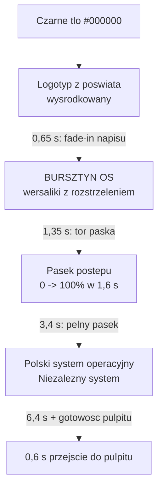

# Ekran powitalny — nowoczesna animacja startowa (2026-11-08)

Zastąpienie poprzedniego szarego ekranu (`0x101720`) z trzema przenikającymi się
napisami animacją opartą na oficjalnym logotypie Bursztyn OS.

## Docelowy wygląd

Kolejność odpowiada opisowi: najpierw samo logo, potem napis pod nim, potem
pasek ładowania, a komunikaty dopiero po zapełnieniu paska.

## Przebieg i czasy

| Czas (µs) | Etap | Co widać |
|---:|---|---|
| 0 – 650 000 | `Logo` | logotyp: alfa 96 → 255 (pierwsza klatka nigdy nie jest pusta) |
| 650 000 – 1 350 000 | `Znak` | pod logotypem pojawia się „BURSZTYN OS”; grupa osiada w środku ekranu |
| 1 350 000 – 1 800 000 | `Znak` | tor paska ładowania rozjaśnia się od zera |
| 1 800 000 – 3 400 000 | `Pasek` | wypełnienie 0 → 100% (smoothstep, gradient bursztynowy) |
| 3 400 000 – 4 150 000 | `Linie` | „Polski system operacyjny” (pełny), „Niezależny system” (przygaszony) |
| 4 150 000 – 6 400 000 | `Linie` | hold; brak fałszywego procentu, pasek stoi na 100% |
| ≥ 6 400 000 + pulpit gotowy | `Zanikanie` | 600 ms przejście do sceny pulpitu |

**Zmienione zostały wyłącznie proporcje wewnątrz animacji.** Niezmienione
pozostają: `MINIMUM_US = 6 400 000`, `FADE_US = 600 000`, bramkowanie zanikania
przez gotowość pulpitu, watchdog 10 s, latch pełnej klatki, `bursztyn.splash=0`,
`bursztyn.test=automated` i `bursztyn.install=1`.

## Decyzje techniczne

### Logotyp bez dekodera PNG na ścieżce startu

`obrazy/logo.png` (840×916, monochromatyczny bursztyn `#FF8800`, reszta alfa = 0)
jest przetwarzany **offline** przez `narzedzia/generuj_maske_logo.py`:

- przycięcie marginesów alfa > 8 → bbox 807×878,
- box-filter kanału alfa → maska pokrycia **294×320** (94 080 B),
- osobna, rozmyta poświata **59×64** (3 776 B) z szerszym polem widzenia
  (`POSWIATA_OD_*`/`POSWIATA_DO_*`), przycięta tak, by nigdy nie była jaśniejsza
  od rdzenia,
- zapis granic atramentu (`MASKA_ATRAMENT_*`, `POSWIATA_ATRAMENT_*`) używanych
  przez układ do centrowania na widocznych pikselach.

Nagłówek `jadro/gui/logo_maska_dane.h` jest wersjonowany i sprawdzany testem
`testy/test_logo_maska.py` (regeneracja musi dać identyczny plik). Dzięki temu
jądro **nie linkuje dekodera DEFLATE** na ścieżce bootu: `png_dekoder.h`
wymagałby wielomegabajtowego sterty i setek milisekund na starcie.

Koszt: ~98 KB `.rodata` (maska + poświata), bez alokacji i bez ścieżki błędu.

### Renderer

`jadro/gui/ekran_powitalny.h` jest w pełni nagłówkowy i bezstanowy wobec
pamięci:

- **Skalowanie maski bilinear 16.16** (bez FPU), z wygaszaniem całej maski przez
  alfę wejścia.
- **Kapsuła paska** z pokryciem liczącym się w półpikselach (`isqrt32`) i
  **symetrycznym gradientem** (jaśniejszy środek, ciemniejsze końce). Gradient
  jednostronny wyglądał na przesunięty, mimo poprawnej geometrii, bo optyczny
  ciężar uciekał na jeden koniec.
- **Napis z rozstrzeleniem** (`napis_rozstrzelony`): rysuje pojedyncze znaki
  przez wspólny `CzcionkaUI::rysuj_tekst_wygladzony`, więc typografia Unicode i
  polskie znaki są te same co w reszcie UI.
- **Centrowanie po atramencie**: `granice_atramentu()` mierzy realne kolumny
  glifów (bit 15 = kolumna 0), a nie szerokości kroków pisma; spacja nie dostaje
  rozstrzelenia. Bez tego pasek i napisy były przesunięte o kilka pikseli.
- **Przycięcie** (`obszar_w_ekranie`, `granica`) respektowane przez logo, pasek
  i tekst — żaden element nie pisze poza prostokątem klatki.

### Sterowanie czasem

Jedna próbka czasu absolutnego (`przelicz(t)`) opisuje całą widoczną treść:

- intro kwantowane do `KROK_US = 80 000` (12,5 Hz), żeby bezczynny desktop nie
  składał pełnej klatki 60 razy na sekundę,
- pasek postępu i zanikanie liczone z czasu ciągłego, żeby ich ruch był płynny,
- `sygnatura()` pozwala kompozytorowi pominąć składanie, gdy próbka nic nie
  zmieniła (`poprzedni_krok` w `ekran_powitalny.cpp`).

Renderer nie używa `float`/`double`, nie alokuje i nie zawiera pętli zależnych od
FPU. Największa ramka stosu w module: 624 B (`powitanie_zrodlo`, ograniczona).

## Zachowane inwarianty

- Brak nowego zadania, timera i przerwania; `powitanie_tick()` nadal woła
  istniejący serwis PID 0.
- Brak `sleep`, busy-wait i blokowania scheduler-a na czas animacji.
- Jedna powierzchnia wielokrotnego użytku, zwalniana po zakończeniu.
- Awaria alokacji powierzchni lub brak HPET nadal kończy animację czystym
  startem (bez zawieszenia).
- Komunikaty i tło pulpitu (`Tlo::Tapeta` / `Tlo::Zastepcze`) bez zmian.

## Testy

| Zestaw | Wynik |
|---|---:|
| `make test-powitanie` (cykl życia, wycentrowanie, maska, opcje, 1700 symulowanych startów) | 15 496 / 15 496 PASS |
| `make test-logo-maska` (`testy/test_logo_maska.py`, kontrakt generacji) | PASS |
| `testy/test_powitanie_policy.py` (kontrakty integracji i renderera) | PASS |
| `make test-splash-timing` (próbki absolutne, przestoje, wycentrowanie, przycięcie) | 1 838 461 / 1 838 461 PASS |
| `make test-splash-first-frame` (kolejność publikacji, piksele, DPI, generacje) | 2 704 734 / 2 704 734 PASS |
| `make test-splash-snapshots` (kompletne klatki 720p/1080p, 100%/125%) | 138 / 138 PASS |
| `make test-splash-production-path` (grafika, kompozytor, VirtIO GPU) | 9 132 266 / 9 132 266 PASS |
| `make test-powitanie-reboot` (teardown, 100 generacji, wątki) | 601 / 601 PASS |

Wszystkie zestawy hostowe działają pod ASan/UBSan. Diagnostyka emituje **etapy,
nie klatki**: 9 wpisów przy 176 próbkach (dawniej jeden wpis na krok).

## Podgląd

`narzedzia/podglad_animacji_startowej.cpp` zapisuje klatki PPM w wybranych
chwilach dla 1280×720, 1920×1080 i 1920×1080@125%. Pomiary wycentrowania w
gotowych klatkach (srodek atramentu − srodek ekranu):

| Element | 1280×720 | 1920×1080 |
|---|---:|---:|
| logo | 0,0 px | −1,0 px |
| „BURSZTYN OS” | −0,5 px | 0,0 px |
| pasek | −0,5 px | −0,5 px |
| „Polski system…” | 0,0 px | 0,0 px |
| „Niezależny system” | 0,0 px | 0,0 px |

Reszta to zaokrąglenie nieparzystej szerokości atramentu do pełnego piksela.

## Naprawione regresje testów (poza animacją)

Trzy zestawy nie przechodziły **przed** tą sesją. Naprawiono je u źródła, nie
przez osłabienie asercji:

| Zestaw | Przyczyna | Poprawka |
|---|---|---|
| `test-startup-visibility` | Reguła `Makefile` nie miała `$(HOST_INCLUDES)` po przenosinach repo do `jadro/`, a fixture nie linkował symboli VMM (`vmm_smap_aktywny`, `vmm_okno_uzytkownika_glebokosc`) wymaganych przez `grafika.cpp`. | Dodane `$(HOST_INCLUDES)` do obu kompilacji; stuby VMM w `testy/test_boot_graphics.cpp` (brak SMAP na hoście). |
| `test-compositor-cursor` | Commit `ca9da93` dodał w kompozytorze `virtio_gpu_get_driver` i `virtio_gpu_pobierz_geometrie_hosta`, ale fixture hostowy nie miał tych symboli → błąd linkowania. | Stuby GPU w fixture: brak kierowcy zwraca `false`, więc kompozytor zachowuje dotychczasową geometrię. |
| `test-virtio-pci` | Commit `ca9da93` świadomie zmienił politykę wyboru trybu na **HOST > bootloader > profil**, a test 108 nadal sprawdzał stary priorytet (bootloader wygrywa). Fałszywe asercje geometrii pociągały za sobą 14 „wycieków DMA” — to była kaskada, nie osobny bug. | Test 108 przepisany na udokumentowaną politykę; testy 109/110 jawnie podają tryb hosta (`setup_mock_gpu_device(&dev, 1280, 720)`). |
| `test-normal-boot` (`test-smoke`) | Zrzut QMP wykonywany natychmiast po gotowości pulpitu trafiał w 600 ms okno zanikania ekranu powitalnego, w którym kursor jest celowo ukryty. | Ograniczone ponawianie zrzutu (`CURSOR_PROBE_ATTEMPTS = 12`, co 250 ms) — kursor musi być widoczny, ale test nie czeka w nieskończoność. |

Dodatkowo `test-smoke` obejmuje teraz `test-startup-visibility`,
`test-compositor-cursor` i `test-powitanie`, żeby te regresje nie wróciły
niezauważone. Wcześniej bramka ich nie uruchamiała.

Jedna uwaga metodologiczna: reguły testów nie mają pliku docelowego jako
zależności, więc `make <cel>` nie przebudowuje binarium po edycji źródła.
Przy weryfikacji po zmianie testu trzeba usunąć `.wm-test/…` albo
`.virtiotest/…` — inaczej uruchamiasz poprzednią kompilację.

## Pliki

**Nowe:** `jadro/gui/logo_maska_dane.h`,
`narzedzia/generuj_maske_logo.py`, `narzedzia/podglad_animacji_startowej.cpp`,
`testy/test_logo_maska.py`.

**Zmienione:** `jadro/gui/ekran_powitalny.h`, `jadro/gui/ekran_powitalny.cpp`,
`Makefile` (reguła generowania maski, zależność `ekran_powitalny.o`, include
dla `test-startup-visibility`, rozszerzona bramka `test-smoke`),
`testy/test_powitanie.cpp`, `testy/test_splash_timing.cpp`,
`testy/test_splash_snapshots.cpp`, `testy/test_splash_first_frame.cpp`,
`testy/test_splash_production_path.cpp`, `testy/test_boot_graphics.cpp`,
`testy/test_powitanie_policy.py`, `testy/test_compositor_cursor.cpp` (stuby GPU),
`testy/test_virtio_pci.cpp` (polityka trybu), `testy/test_normal_boot_qemu.py`
(ponawianie zrzutu kursora), `.gitignore`.

**Niezmienione:** ABI BWS, kompozytor, sterowniki grafiki/GPU, tapety, WM, czcionki
systemowe, wszystkie ścieżki startu diagnostycznego.
