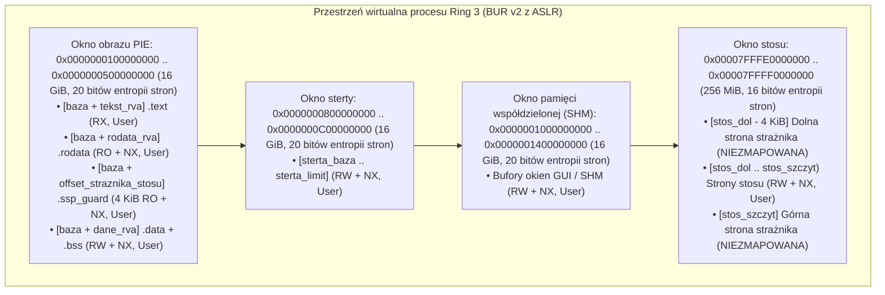

# Bursztyn OS — Implementacja relokowalnego formatu wykonywalnego BUR v2 (`BUR\x02`) oraz ASLR dla procesów Ring 3 (2026-11-04)

## 1. Streszczenie wykonawcze

Niniejszy dokument opisuje pełną architekturę, specyfikację binarną, implementację jądra oraz weryfikację testową relokowalnego formatu wykonywalnego **BUR v2 (`BUR\x02`)** i wieloregionowego **ASLR (Address Space Layout Randomization)** dla procesów przestrzeni użytkownika (Ring 3) w systemie **Bursztyn OS**.

Kluczowe rezultaty wdrożenia:
- **Dwuformatowy loader produkcyjny** ([`loader.cpp`](file:///home/programista/Pulpit/Burstzyn/BursztynOS/loader.cpp), [`loader.h`](file:///home/programista/Pulpit/Burstzyn/BursztynOS/loader.h), [`bur_v2.h`](file:///home/programista/Pulpit/Burstzyn/BursztynOS/bur_v2.h)): pełna obsługa nowego formatu relokowalnego **BUR v2** (`BUR\x02`, nagłówek 160 B) przy zachowaniu 100% wstecznej kompatybilności z klasycznym formatem stałoadresowym **BUR v1** (`BUR\0`, nagłówek 60 B).
- **Domyślna kompilacja wszystkich 23 aplikacji Ring 3 jako PIE BUR v2** (`BUR_FORMAT ?= 2` w [`Makefile`](file:///home/programista/Pulpit/Burstzyn/BursztynOS/Makefile#L188)) przy użyciu `-fPIE -mcmodel=small -fvisibility=hidden`, skryptu [`bur_v2_linker.ld`](file:///home/programista/Pulpit/Burstzyn/BursztynOS/bur_v2_linker.ld) oraz konwertera [`narzedzia/elftoburv2.py`](file:///home/programista/Pulpit/Burstzyn/BursztynOS/narzedzia/elftoburv2.py).
- **Kryptograficzne źródło entropii ChaCha20 CSPRNG** ([`entropia.h`](file:///home/programista/Pulpit/Burstzyn/BursztynOS/entropia.h), [`entropia.cpp`](file:///home/programista/Pulpit/Burstzyn/BursztynOS/entropia.cpp)) zasilane ze sprzętowych źródeł (`VirtIO-RNG`, `RDSEED`, `RDRAND`, `RDTSC`, `CMOS RTC`) z automatycznym, ciągłym dosypywaniem entropii (`re-seeding`).
- **Wieloregionowy ASLR per-proces** ([`aslr_wylosuj_uklad_procesu`](file:///home/programista/Pulpit/Burstzyn/BursztynOS/bur_v2.h#L168-L192)): niezależna randomizacja bazy obrazu PIE (20 bitów entropii stron), sterty (20 bitów), pamięci współdzielonej SHM (20 bitów) oraz szczytu stosu (16 bitów).
- **Rygorystyczne W^X i izolacja kanarka SSP (`.ssp_guard`)**: separacja `.text` (`RX`), `.rodata` (`RO+NX`), dedykowanej strony `.ssp_guard` (`RO+NX`, inicjalizowanej przez jądro przez okno HHDM przed wejściem do Ring 3) oraz `.data`/`.bss` (`RW+NX`).
- **Symbolikacja awarii ASLR** ([`idt.cpp`](file:///home/programista/Pulpit/Burstzyn/BursztynOS/idt.cpp#L830-L845), [`narzedzia/symbolicate_bur_v2_crash.py`](file:///home/programista/Pulpit/Burstzyn/BursztynOS/narzedzia/symbolicate_bur_v2_crash.py)): logowanie `base=0x... rva=0x... bur=v...` przy każdym wyjątku `[USER FAULT]` oraz automatyczne tłumaczenie `RVA = RIP - load_base` na plik/linię kodu za pomocą prywatnych artefaktów `.release-private/apps/<sha256>/app.elf`.

---

## 2. Wyjaśnienie historycznej rozbieżności rozmiaru nagłówka BUR v1 (60 B vs 64 B)

W starszych opisach tekstowych formatu BUR v1 pojawiała się wzmianka o „64-bajtowym nagłówku”. Audyt kodu źródłowego ([`loader.h`](file:///home/programista/Pulpit/Burstzyn/BursztynOS/loader.h#L76-L86)) wykazał jednoznacznie, że rzeczywista struktura binarna [`NaglowekBur`](file:///home/programista/Pulpit/Burstzyn/BursztynOS/loader.h#L76-L86) posiada atrybut `__attribute__((packed))` i składa się z:
- `uint8_t magia[4]` (`"BUR\0"`, 4 bajty, offset `0x00`),
- 7 pól `uint64_t` (`punkt_wejscia`, `tekst_przesuniecie`, `tekst_rozmiar`, `tekst_wirtualny`, `dane_przesuniecie`, `dane_rozmiar`, `dane_wirtualny` — $7 \times 8 = 56$ bajtów, offsety `0x04..0x3B`).

Łączny rozmiar binarny [`NaglowekBur`](file:///home/programista/Pulpit/Burstzyn/BursztynOS/loader.h#L76-L86) wynosi dokładnie **60 bajtów** (`static_assert(sizeof(NaglowekBur) == 60)`), umieszczonych na początku 4096-bajtowej strony `.naglowek`. Liczba 64 B wynikała wyłącznie z teoretycznego wyrównania niespakowanej struktury C w 64-bitowym ABI (4 bajty wyrównania po `magia[4]`).

---

## 3. Specyfikacja binarna formatu BUR v2 (`NaglowekBurV2` — 160 bajtów)

Format **BUR v2** rozpoczyna się od 4096-bajtowej strony metadanych (`.naglowek`), na której początku (offset `0x0000`) znajduje się 160-bajtowa struktura [`NaglowekBurV2`](file:///home/programista/Pulpit/Burstzyn/BursztynOS/bur_v2.h#L69-L106) (`static_assert(sizeof(NaglowekBurV2) == 160)`):

| Offset | Pole | Typ | Rozmiar | Opis / Inwariant walidatora |
|---:|---|---|---:|---|
| `0x00` | `magia[4]` | `uint8_t[4]` | 4 B | Sygnatura `"BUR\x02"` (`0x42, 0x55, 0x52, 0x02`) |
| `0x04` | `wersja` | `uint16_t` | 2 B | Wersja formatu = `2` (`BUR_V2_WERSJA`) |
| `0x06` | `rozmiar_naglowka` | `uint16_t` | 2 B | Dokładnie `160` (`sizeof(NaglowekBurV2)`) |
| `0x08` | `architektura` | `uint16_t` | 2 B | `62` (`EM_X86_64`) |
| `0x0A` | `abi` | `uint16_t` | 2 B | `1` (`BUR_V2_ABI_V1`) |
| `0x0C` | `flagi` | `uint32_t` | 4 B | Maska bitowa `BUR_V2_FLAGA_*` (`PIE \| WX \| RO_RODATA \| RO_GUARD \| NX_STACK_HEAP = 0x1F`) |
| `0x10` | `wymagane_funkcje` | `uint32_t` | 4 B | Maska `BUR_V2_WYMAGANE_*` (`0x07`) |
| `0x14` | `minimalne_wyrownanie_strony` | `uint32_t` | 4 B | `4096` (`0x1000`) |
| `0x18` | `punkt_wejscia_rva` | `uint64_t` | 8 B | RVA punktu wejścia `_start` wewnątrz segmentu `.text` |
| `0x20` | `tekst_przesuniecie` | `uint64_t` | 8 B | Offset plikowy `.text` (`0x1000`, wyrównany do 4 KiB) |
| `0x28` | `tekst_rozmiar` | `uint64_t` | 8 B | Rozmiar `.text` w bajtach (wielokrotność 4 KiB, `> 0`) |
| `0x30` | `tekst_rva` | `uint64_t` | 8 B | RVA segmentu `.text` (`0x1000`) |
| `0x38` | `rodata_przesuniecie` | `uint64_t` | 8 B | Offset plikowy `.rodata` (`tekst_przesuniecie + tekst_rozmiar` lub `0`) |
| `0x40` | `rodata_rozmiar` | `uint64_t` | 8 B | Rozmiar `.rodata` w bajtach (wielokrotność 4 KiB) |
| `0x48` | `rodata_rva` | `uint64_t` | 8 B | RVA segmentu `.rodata` (`tekst_rva + tekst_rozmiar`) |
| `0x50` | `dane_przesuniecie` | `uint64_t` | 8 B | Offset plikowy `.data` (wyrównany do 4 KiB, za `.rodata`) |
| `0x58` | `dane_rozmiar_pliku` | `uint64_t` | 8 B | Rozmiar zainicjalizowanych danych `.data` w pliku (`<= dane_rozmiar_pamieci`) |
| `0x60` | `dane_rozmiar_pamieci` | `uint64_t` | 8 B | Łączny rozmiar `.data + .bss` w pamięci (wielokrotność 4 KiB, `> 0`) |
| `0x68` | `dane_rva` | `uint64_t` | 8 B | RVA segmentu `.data` (`offset_straznika_stosu + 0x1000`) |
| `0x70` | `reloc_przesuniecie` | `uint64_t` | 8 B | Offset tabeli relokacji w pliku (za `.data` lub `0` gdy brak relokacji) |
| `0x78` | `reloc_liczba` | `uint32_t` | 4 B | Liczba wpisów `BurV2Relokacja` (`<= 65536`) |
| `0x7C` | `reloc_rozmiar_wpisu` | `uint16_t` | 2 B | `24` (`sizeof(BurV2Relokacja)`) lub `0` gdy `reloc_liczba == 0` |
| `0x7E` | `domyslne_strony_stosu` | `uint16_t` | 2 B | Domyślna liczba stron stosu (`1..64`, standardowo `16` = 64 KiB) |
| `0x80` | `offset_straznika_stosu` | `uint64_t` | 8 B | RVA dedykowanej strony `.ssp_guard` (wyrównane do 4 KiB, pomiędzy `.rodata` a `.data`) |
| `0x88` | `zastrzezone0` | `uint32_t` | 4 B | Musi wynosić `0` |
| `0x8C` | `zastrzezone1` | `uint32_t` | 4 B | Musi wynosić `0` |
| `0x90` | `zastrzezone2` | `uint64_t` | 8 B | Musi wynosić `0` |
| `0x98` | `suma_kontrolna_naglowka` | `uint64_t` | 8 B | 64-bitowy skrót FNV-1a pierwszych 152 bajtów nagłówka ([`bur_v2_oblicz_sume_naglowka`](file:///home/programista/Pulpit/Burstzyn/BursztynOS/bur_v2.h#L156-L166)) |

### Format wpisu relokacji (`BurV2Relokacja` — 24 bajty)

Każdy wpis [`BurV2Relokacja`](file:///home/programista/Pulpit/Burstzyn/BursztynOS/bur_v2.h#L108-L115) (`static_assert(sizeof(BurV2Relokacja) == 24)`) opisuje relokację typu `BUR_V2_RELOC_ABS64 (1)` wewnątrz zapisywalnego segmentu `.data`:
- `uint64_t rva_celu`: ściśle rosnący, niepokrywający się adres RVA wewnątrz `[dane_rva, dane_rva + dane_rozmiar_pamieci - 8]`,
- `int64_t addend`: docelowe przesunięcie RVA wskazywanego symbolu wewnątrz obrazu (`[tekst_rva, dane_rva + dane_rozmiar_pamieci)`),
- `uint32_t typ`: `BUR_V2_RELOC_ABS64 = 1`,
- `uint32_t zastrzezone`: `0`.

Relokacje nigdy nie modyfikują stron wykonywalnych `.text` ani `.rodata` (`-Wl,-z,text`), zachowując ścisłą niezmienność stron kodu i czystość W^X.

---

## 4. Architektura ASLR i układ pamięci wirtualnej procesu Ring 3

Funkcja [`aslr_wylosuj_uklad_procesu`](file:///home/programista/Pulpit/Burstzyn/BursztynOS/bur_v2.h#L168-L192) losuje dla każdego procesu BUR v2 cztery niezależne bazy w niepokrywających się oknach kanonicznej dolnej połowy przestrzeni adresowej x86-64 (`< 0x0000800000000000`):

### Uprawnienia stron (W^X + NX)
1. **`.text`**: `VMM_FLAG_PRESENT | VMM_FLAG_USER` (tylko odczyt i wykonanie, brak bitu `WRITABLE`, brak bitu `NX`).
2. **`.rodata`**: `VMM_FLAG_PRESENT | VMM_FLAG_USER | VMM_FLAG_NX` (tylko odczyt, zakaz zapisu i wykonania).
3. **`.ssp_guard`**: osobna 4-kilobajtowa ramka fizyczna wypełniona losowym kanarkiem procesu przez jądro poprzez okno HHDM (`vmm_phys_to_virt`), a następnie zmapowana do przestrzeni użytkownika z flagami `VMM_FLAG_PRESENT | VMM_FLAG_USER | VMM_FLAG_NX` (tylko odczyt i NX). Próba nadpisania `__stack_chk_guard` przez proces Ring 3 natychmiast wywołuje `#PF` i zabija proces.
4. **`.data` / `.bss` / Sterta / Stos / SHM**: `VMM_FLAG_PRESENT | VMM_FLAG_WRITABLE | VMM_FLAG_USER | VMM_FLAG_NX` (zapis i odczyt, bezwzględny zakaz wykonywania instrukcji).

---

## 5. Przepływ ładowania, relokacji i atomowego wycofywania (Rollback) w `loader.cpp`

Funkcja [`zaladuj_program_bur`](file:///home/programista/Pulpit/Burstzyn/BursztynOS/loader.cpp) implementuje transakcyjne tworzenie przestrzeni adresowej procesu:
1. **Rozpoznanie formatu**:
   - `"BUR\0"` $\rightarrow$ ścieżka klasyczna BUR v1 (stałe adresy `0x1001000`, sterta `0x800000000`, stos `0x7FFFF0000000`).
   - `"BUR\x02"` $\rightarrow$ walidacja [`bur_v2_waliduj_plik`](file:///home/programista/Pulpit/Burstzyn/BursztynOS/bur_v2.h#L194-L320), pobranie 32 bajtów kryptograficznej losowości z [`entropia_pobierz_bajty`](file:///home/programista/Pulpit/Burstzyn/BursztynOS/entropia.cpp) oraz wylosowanie układu ASLR przez [`aslr_wylosuj_uklad_procesu`](file:///home/programista/Pulpit/Burstzyn/BursztynOS/bur_v2.h#L168-L192). W przypadku braku bezpiecznej entropii lub braku aktywnego bitu NX dla obrazu wymagającego `BUR_V2_FLAGA_WX`, loader odmawia uruchomienia (`fail-closed`).
2. **Alokacja ramek i mapowanie segmentów**:
   - Wszystkie zaalokowane ramki PMM są rejestrowane na liście transakcyjnej `AlokacjaRamekLoadera`.
   - Jądro kopiuje zawartość `.text`, `.rodata` oraz `.data` przez HHDM, zeruje `.bss`, wykonuje [`bur_v2_zastosuj_relokacje_danych`](file:///home/programista/Pulpit/Burstzyn/BursztynOS/bur_v2.h#L322-L353) na stronach `.data` przez HHDM, zapisuje losowy 64-bitowy kanarek na stronie `.ssp_guard` i mapuje strony z docelowymi uprawnieniami W^X.
3. **Wycofanie po błędzie (`wycofaj_zasoby_loadera`)**:
   - Jeśli na którymkolwiek etapie (alokacja PML4, ramki segmentu, strony strażnika, stosu lub tablic stron VMM) wystąpi błąd braku pamięci, loader odmapowuje wszystkie częściowo zmapowane strony, zwalnia wszystkie ramki PMM wraz z pośrednimi tablicami stron (`vmm_zwolnij_przestrzen_uzytkownika`) i zwalnia slot procesu — gwarantując **zero wycieków pamięci**.

---

## 6. Porównanie wszystkich 23 aplikacji Ring 3 (BUR v1 vs BUR v2)

Wszystkie 23 aplikacje pierwszostronne zostały zmigrowane do formatu BUR v2 (`BUR\x02`). Pełne dane maszynowe znajdują się w pliku [`docs/bur-v2-aslr-2026-11-04/apps-v1-vs-v2.json`](file:///home/programista/Pulpit/Burstzyn/BursztynOS/docs/bur-v2-aslr-2026-11-04/apps-v1-vs-v2.json):

| Aplikacja | Rozmiar v1 (B) | Rozmiar v2 (B) | Zmiana (B) | `.text` (B) | `.rodata` (B) | `.ssp_guard` RVA | `.data` plik / pamięć (B) | Relokacje | SHA-256 (BUR v2) |
|---|---:|---:|---:|---:|---:|---:|---:|---:|---|
| `aktualizacje.bin` | 202 368 | 161 296 | -41 072 | 86 016 | 53 248 | `0x23000` | 8 192 / 16 384 | 406 | `c9a26492a4c9a514...` |
| `demo_ui.bin` | 300 672 | 276 200 | -24 472 | 163 840 | 57 344 | `0x37000` | 16 384 / 24 576 | 1 439 | `a47bc12711ca5a0e...` |
| `diagnostyka.bin` | 202 368 | 232 848 | +30 480 | 139 264 | 53 248 | `0x30000` | 12 288 / 1 646 592 | 998 | `ef6698eaee999219...` |
| `ekran.bin` | 235 136 | 263 040 | +27 904 | 176 128 | 53 248 | `0x39000` | 12 288 / 20 480 | 720 | `af7573646dab2cc3...` |
| `eksplorator.bin` | 284 320 | 305 184 | +20 864 | 192 512 | 57 344 | `0x3e000` | 16 384 / 57 344 | 1 452 | `c79fe7a8d93fe28b...` |
| `fpu_probe.bin` | 69 856 | 16 384 | -53 472 | 4 096 | 4 096 | `0x3000` | 4 096 / 8 192 | 0 | `f665bc3bc54aac81...` |
| `husarz_worker.bin` | 69 888 | 61 440 | -8 448 | 49 152 | 4 096 | `0xe000` | 4 096 / 270 336 | 0 | `fd836439c5bf2cdb...` |
| `instalator.bin` | 202 368 | 218 640 | +16 272 | 143 360 | 53 248 | `0x31000` | 8 192 / 16 384 | 406 | `742b29e37a1c8a79...` |
| `kalkulator.bin` | 202 496 | 145 984 | -56 512 | 77 824 | 49 152 | `0x20000` | 8 192 / 16 384 | 280 | `4fa45fe3a762dc92...` |
| `kontrolki2.bin` | 300 672 | 238 360 | -62 312 | 143 360 | 53 248 | `0x31000` | 12 288 / 36 864 | 1 057 | `6eea083975158f61...` |
| `kontrolki3.bin` | 218 752 | 248 616 | +29 864 | 151 552 | 53 248 | `0x33000` | 12 288 / 24 576 | 1 143 | `08f13f04cc2e9575...` |
| `kontrolki4.bin` | 333 888 | 377 472 | +43 584 | 229 376 | 61 440 | `0x48000` | 24 576 / 32 768 | 2 416 | `ff5454bf28951fe8...` |
| `menedzer_okien.bin` | 373 344 | 392 624 | +19 280 | 217 088 | 57 344 | `0x44000` | 73 728 / 122 880 | 1 682 | `599d4dd6f5ae8eeb...` |
| `notatnik.bin` | 202 368 | 207 944 | +5 576 | 126 976 | 53 248 | `0x2d000` | 8 192 / 81 920 | 643 | `c788fb22a3917606...` |
| `przegladarka.bin` | 562 880 | 546 712 | -16 168 | 425 984 | 73 728 | `0x7b000` | 16 384 / 139 264 | 1 105 | `6a36c48a81c38acd...` |
| `przegladarka_obrazow.bin` | 136 864 | 106 496 | -30 368 | 49 152 | 49 152 | `0x19000` | 4 096 / 16 384 | 0 | `41491a2dba5f48c1...` |
| `repro.bin` | 36 880 | 12 288 | -24 592 | 4 096 | 4 096 | `0x3000` | 0 / 4 096 | 0 | `06e2cffee99d0cd7...` |
| `shell.bin` | 153 312 | 170 056 | +16 744 | 94 208 | 57 344 | `0x26000` | 8 192 / 106 496 | 259 | `5bb9a39dfcda6351...` |
| `snake.bin` | 138 752 | 102 400 | -36 352 | 40 960 | 49 152 | `0x17000` | 8 192 / 16 384 | 0 | `a7bdc5512a3b7994...` |
| `tapety.bin` | 284 320 | 314 352 | +30 032 | 204 800 | 57 344 | `0x41000` | 16 384 / 57 344 | 1 322 | `2cfdde77935ba4f3...` |
| `test.bin` | 530 080 | 565 240 | +35 160 | 376 832 | 86 016 | `0x72000` | 28 672 / 57 344 | 2 901 | `633907e1b70e3488...` |
| `test_dzwieku.bin` | 206 464 | 232 368 | +25 904 | 135 168 | 57 344 | `0x30000` | 12 288 / 4 509 696 | 978 | `5aed4c38fe0b8f0e...` |
| `ustawienia.bin` | 202 368 | 234 728 | +32 360 | 131 072 | 53 248 | `0x2e000` | 16 384 / 24 576 | 1 247 | `a49d61f8088f4538...` |

---

## 7. Podsumowanie weryfikacji hostowej, fuzzingu i testów systemowych QEMU

1. **Testy jednostkowe i mutacyjne na hoście (ASan + UBSan)**:
   - `make test-bur-v2-aslr-host` ([`narzedzia/test_bur_v2_aslr_host.cpp`](file:///home/programista/Pulpit/Burstzyn/BursztynOS/narzedzia/test_bur_v2_aslr_host.cpp)): **PASS** — kompatybilność BUR v1, odrzucanie uszkodzonych nagłówków/relokacji BUR v2, 10 000 prób losowania układu ASLR (0 kolizji), 30 000 prób mutacyjnych na każdym z 23 plików `.bin` (**690 000 mutacji bez awarii sanitizera**).
   - `python3 narzedzia/test_bur_loader.py`: **PASS** (35 testów C++ + 17 testów integralności `aktualizacje.bin`).
   - `python3 narzedzia/test_dzwieku_repair.py`: **PASS** — **1 165 etapów deterministycznego wstrzykiwania błędów alokacji ramek PMM i mapowania VMM** dla obrazu BUR v2 (`frame_budget = 0..1164`, `map_budget = 0..1164`), blokada braku NX i braku entropii, 0 wycieków ramek, **11 287 589 asercji** pod ASan/UBSan.
   - `make test-stack-protector-host`: **PASS** (2 007 asercji ASan + test śmierci `__stack_chk_fail`).
   - `make test-fuzz-smoke` ([`narzedzia/fuzz/fuzz_bur_v2.cpp`](file:///home/programista/Pulpit/Burstzyn/BursztynOS/narzedzia/fuzz/fuzz_bur_v2.cpp), [`narzedzia/fuzz/fuzz_bur_loader.cpp`](file:///home/programista/Pulpit/Burstzyn/BursztynOS/narzedzia/fuzz/fuzz_bur_loader.cpp) + 6 pozostałych fuzzerów): **PASS** (45 068 wykonań z pokryciem `trace-pc`, 0 awarii).
2. **Testy systemowe QEMU ([`narzedzia/test_bur_v2_qemu.py`](file:///home/programista/Pulpit/Burstzyn/BursztynOS/narzedzia/test_bur_v2_qemu.py), [`narzedzia/test_bws_abuse_qemu.py`](file:///home/programista/Pulpit/Burstzyn/BursztynOS/narzedzia/test_bws_abuse_qemu.py))**:
   - `make test-bur-v2-qemu`: **PASS (`[26, 26, 26, 26, 26]`)** — 26 uruchomień sondy BUR v2 równolegle z klasycznym procesem BUR v1 (`fpu_probe.bin`); wszystkie 5 kolumn (`code`, `stack`, `heap`, `canary_address`, `shared_mapping`) uzyskało 26/26 unikalnych adresów; wszystkie 6 testów negatywnych (`g` zapis do `.ssp_guard`, `t` zapis do `.text`, `r` zapis do `.rodata`, `h` wykonanie ze sterty, `s` wykonanie ze stosu, `c` przepełnienie bufora stosu SSP) zostało przechwyconych bez naruszenia stabilności jądra, a skrypt [`narzedzia/symbolicate_bur_v2_crash.py`](file:///home/programista/Pulpit/Burstzyn/BursztynOS/narzedzia/symbolicate_bur_v2_crash.py) poprawnie rozwiązał losowe adresy RIP do linii w `bur_v2_probe.cpp`.
   - `make test-bws-abuse-qemu`: **PASS** — wszystkie 6 kategorii testów odporności wywołań systemowych BWS z Ring 3 zakończone sukcesem.
   - Rozruch produkcyjnego obrazu `BursztynOS.iso` (`SHA-256: c7829432b49381e44aaf53adf060872b307158ca9684cd335ab89f9456fbe37a`) w QEMU: **PASS** — pełny start pulpitu (`[WM] Initial Desktop ready`) oraz aplikacji `diagnostyka.bur` w Ring 3 (`[DIAG APP] First frame submitted`) w formacie BUR v2 z aktywnym ASLR, `0` błędów `[BUR FAIL]` i `0` błędów `[USER FAULT]`.
   - Audyt metadanych wydania (`verifyreleasemetadata.py` + `test_release_metadata.py`): **PASS** (616 plików na ISO, 0 znalezisk, pełna separacja symboli debugowych w `.release-private/`).
